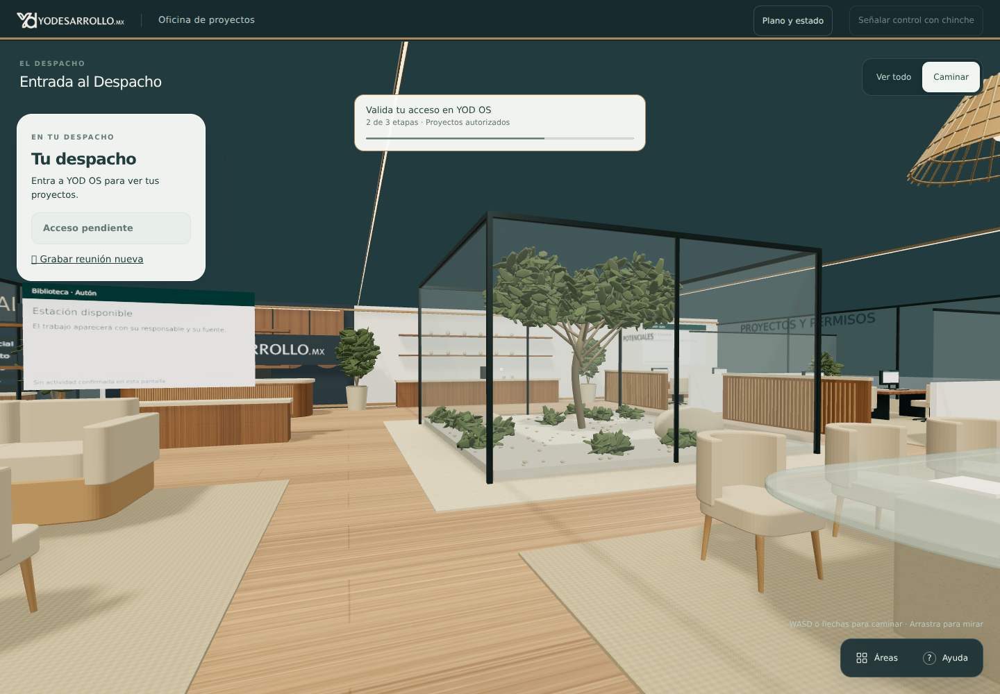
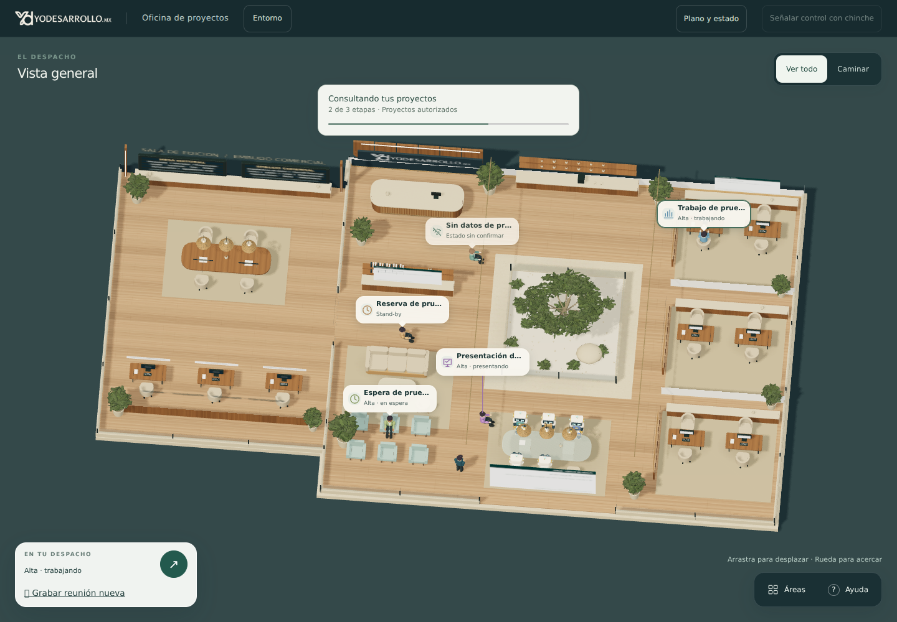

# Despacho: estados, lugares y entrada — 28 octubre 2026

Publicado mediante PR316, PR319, PR320 y PR321. Portero104 devuelve al propietario autorizado el estado documental de cada caso desde sus fuentes privadas, aunque el motor no tenga señal reciente. Los estados de ejecución se consultan por POST autenticado `/fast/auton-status`, cuerpo vacío, para cada identidad autorizada. El navegador valida caso, frescura, revisión y coherencia: el catálogo nunca acredita trabajo ni presentación en curso. Un error de lectura no significa baja. Aprobar una presentación conserva la etapa comercial.

| Evidencia | Lugar y pose |
| --- | --- |
| Alta y ejecución reciente | Puesto propio, sentado |
| Alta en espera | Sillón cerca de entrada, sentado |
| Stand-by | Zona apartada de puestos, de pie |
| Revisión real del consejo activa | Ante la mesa del consejo, de pie |
| Baja | Fuera de escena, expediente conservado |
| Sin datos o datos vencidos | Zona neutral, estado sin confirmar |

La entrada usa cámara en primera persona. Dirección tiene avatar propio independiente de los casos, controles de movimiento y botón para volver a vista superior conservando posición. `OFICINA_PRIMERA_PERSONA` permite revertir esta entrada. `OFICINA_ESTADOS_REALES` y el interruptor multicaso están activos. Un navegador sin WebGL recibe el plano accesible, con el mismo estado y lugar autorizado.

Validación final: 1070 pruebas del portal aprobadas; 706 privadas aprobadas y una integración opcional omitida. Verificadores OS, portal, accesos, obra y arquitectura aprobados. El CI de PR321 verificó entrada, identidad, puesto, reunión, trabajo observable, recorrido, conocimiento, voz y PPP colaborativo. Chromium y WebKit aprobaron sus comprobaciones. Chromium local con WebGL mostró primera persona, vista superior y tamaño móvil 390×844. Las capturas de seis estados usan identidades sintéticas y no acreditan actividad productiva. Baja queda fuera: cinco figuras de seis casos. No se publican nombres, fuentes ni identidades de casos reales.

El repositorio privado contiene el lector de Proyectos, el endpoint y el registro con vínculos de proyecto y múltiples modelos por caso. Dos expedientes documentales adicionales están activos sin crear trabajadores ni permisos de ejecución. El puente Vertical no se ha verificado. El correo de cierre y respuesta del consejo sigue sin conexión verificada. No inferir actividad por la apariencia del avatar ni por una respuesta HTTP correcta del servicio.

La instalación autorizada se completó en la implementación existente de Apps Script, conservando su URL y permisos. Portero104 revalida al propietario también después de leer las fuentes. La interfaz publicada usa la versión `records2`. La prueba autenticada en producción confirmó espera en sillones de entrada, stand-by en zona de espera y baja fuera de la oficina. Las capturas de producción con datos reales se conservan privadamente.

Capturas de QA local: primera persona, vista superior y proyección sintética. No son capturas de producción.

## Activación y catálogo documental

Cuatro consultas autenticadas de lectura devolvieron HTTP200 con identidad y referencia correctas. Se admite lectura lenta hasta 45s; las rondas siguen seriales. La comprobación operativa no encontró señal reciente de trabajador conectado en esos cuatro casos: el catálogo permite ver su admisión documental, pero no acredita ejecución. Registros documentales no solicitan sesiones del motor ni afirman puente PPP operativo. Catálogo hasta 16, seis plazas visibles y baja libera plaza conservando expediente. Reversión: apagar `OFICINA_ESTADOS_REALES` y `YOD_AUTON_RECORDS_ENABLED`; no borrar fuentes ni registros.

La expectativa activa sin una fuente vigente es «Estado sin confirmar». Una respuesta tardía del motor no puede deshacer una baja de una revisión posterior. La revocación del catálogo elimina perfiles, estados y credenciales de memoria.

El clic de Dirección selecciona el caso y abre sus opciones. En el consejo, «Devolver al consejo» guarda observaciones; «Aceptar esta entrega» requiere una sesión lista y conserva la etapa comercial. Estos controles no reparan una conexión ausente ni acreditan lectura del modelo financiero.
