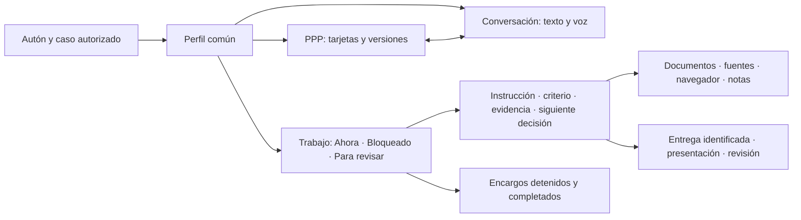

# Perfil común del autón · rediseño con Gastón
Registro: 12-oct-2026, America/Hermosillo (UTC−7). Estado al 2026-10-12 21:58:49 UTC: perfil, PPP, arranque de voz y corrección de lectura142 publicados. El recorrido privado previo detectó un fallo de recuperación; su repetición tras142 y el micrófono siguen pendientes. No se declara100% operativo. El recorrido autenticado y el micrófono físico permanecen pendientes; la bitácora mutua conserva sus recibos.
La revisión partió del portal `5169b195` y del arranque nativo de Patrimonial; el candidato conserva también las integraciones posteriores de reuniones. No representa capturas de la sesión privada ni mediciones físicas del micrófono.

## Resultado que debe permitir
Abrir al autón, ver el mismo PPP autorizado y conversar sobre una tarjeta, entender el siguiente encargo y revisar su evidencia sin reconstruir información dispersa. Gastón inicia la prueba; Luis y Ruiseñor usan el mismo perfil y las mismas capacidades bajo sus permisos.

## Diagnóstico por superficie
| Superficie | Hallazgo de fuente | Consecuencia y corrección |
|---|---|---|
| Apertura | La preparación podía dejar esperando al caso seleccionado detrás de lecturas pendientes. El broker ya comparte lecturas en vuelo. | Priorizar el caso elegido dentro de la cola existente; conservar identidad/caso/credencial vigentes. No instalar un segundo caché ni guardar permisos persistentes. |
| PPP | El piloto depende de documentos para localizar su tablero; otros perfiles reciben descriptor explícito. | La lectura autorizada confirmó un vínculo único del piloto con su PPP. Se conserva ese mecanismo y sus comprobaciones; no se inventa una relación por nombre ni se escribe un ID privado en el frontend. |
| PPP nativo | Arranque Patrimonial espera catálogo antes de caso; un error temporal puede invocar el gate y borrar sesión compartida. | Lectura exacta del caso independiente del catálogo, espera acotada, error local y protección de respuestas tardías. |
| Navegación | Ocho superficies organizadas en grupos; los mismos datos se repiten en voz, resumen, actividad y objetivos. | PPP persistente, conversación lateral y bandeja contextual de trabajo. |
| Pendientes | Son encargos de análisis del runtime; no equivalen automáticamente a metas/acciones MOAC. | Etiquetar procedencia y distinguir estado de negocio, encargo, intento y entrega. |
| Siguiente acción | Orden por estado/actualización y número de tarea; no prioridad empresarial estructurada. | Mostrar una siguiente acción respaldada por estado e instrucción, sin inventar prioridad ni método. |
| Presentaciones | Existe presentación derivada de entrega real con revisión exacta y guion. | Reutilizarla desde la entrega; conservar grabación y reuniones en curso. |

La reproducción aislada del bootstrap detecta que lista={ok:false,error:lock_busy} lleva a borrar la sesión y no abrir el caso. Es un defecto de código; no demuestra que ése fuera el error particular de la sesión de Alejandro. Las demoras deben medirse, no inferirse por ese diagnóstico.

## Estructura del perfil
1. Cabecera compacta: nombre, proyecto, disponibilidad y fecha de información. El avatar identifica y no ocupa el lienzo.
2. PPP principal: tablero nativo, tarjetas cerradas y selección compartida. Conversación sigue visible al consultar una tarjeta.
3. Conversación: registro continuo, texto y voz. Un control de interrupción visible; diagnóstico/opciones plegados.
4. Trabajo: Ahora, Bloqueado y Para revisar. Historial detenido/completado aparte; no anunciarlo como nuevo pendiente.
5. Ficha contextual: resultado esperado, criterio, instrucción, fuentes disponibles, estado, evidencia y bloqueo. Un método ausente se declara, no se rellena con ficción.
6. Instrumentos: documentos, navegador y notas/versiones siguen disponibles, asociados al trabajo, sin competir como ocho destinos primarios.
7. Entrega: presentación desde un resultado identificado; una o dos láminas por tema, guion de esa versión, preguntas y revisión. Revisión técnica no altera negocio.

La rueda mantiene cuatro destinos conocidos y acceso por teclado/toque. Acercarse puede abrir la rueda; la conversación por proximidad sigue como cápsula y ampliar conserva el canal de voz. Cambiar una dirección no crea encargos. El PPP y los instrumentos se conservan al cambiar de vista; cambiar de caso invalida datos del anterior.

## Modelo de trabajo y estados
| Registro | Autoridad | Qué significa |
|---|---|---|
| PPP | Libro y motor canónicos del caso | Datos, tarjetas, versiones y cálculos compartidos |
| Meta/acción de negocio | MOAC expresamente vinculado | Compromiso y estado empresarial |
| Encargo | Solicitud durable autorizada | Resultado que se delegó y criterio de entrega |
| Ejecución | Lease, intento y herramientas observadas | Trabajo realmente en curso o interrumpido |
| Entrega | Evidencia y recibo exactos | Preparado para revisión |
| Presentación | Derivada de una entrega | Explicación breve; no aceptación automática |
| Conversación | Mensajes e intenciones explícitas | Hablar no equivale a guardar un encargo |
| Historial | Intentos, cambios y decisiones | Reconstrucción; abrir no reanuda |

Ahora requiere una ejecución vigente o un encargo explícito disponible. Bloqueado muestra la causa y la siguiente decisión. Para revisar requiere evidencia registrada. Las metas detenidas o aceptadas quedan en historial. El esquema actual no contiene método/fuentes por tarea estructurados: la interfaz utiliza únicamente instrucción/criterio/evidencia existentes y señala campos ausentes.

## Métodos utilizados
Son adaptaciones propias de principios publicados; los autores no participan ni firman esta revisión.
- Alex Hormozi: reducir demora y esfuerzo para obtener un resultado confiable. Se traduce en PPP/conversación simultáneos y evidencia visible, no en promesas o porcentajes inventados. [Checklist de valor](https://www.acquisition.com/hubfs/Offer%20Checklists%20-%20PDF%20Downloads/Pricing-Value-Checklist.pdf?hsLang=en).
- John Maxwell: equipar con ejemplo, acompañamiento, observación y corrección. Cada tipo de encargo debe tener criterio de buena entrega, herramienta disponible y revisión reutilizable. [Four Ways to Equip People](https://www.maxwellleadership.com/podcast/four-ways-to-equip-people/).
- Brian Tracy: ordenar por consecuencias y concentrarse en la acción prioritaria. La sugerencia debe explicar dependencia/impacto; delegar no concede permiso para borrar objetivos. [Método ABCDE](https://www.briantracy.com/blog/time-management/the-abcde-list-technique-for-setting-priorities/).
- UX: estado visible, control, consistencia y reconocimiento. Un fallo muestra recuperación local y conserva el trabajo autorizado. [Heurísticas de usabilidad](https://www.nngroup.com/articles/ten-usability-heuristics/).

## Método del autón
Leer el PPP y vínculos autorizados → fijar resultado y criterio → revisar biblioteca interna → investigar fuera cuando falte información → distinguir hechos/supuestos → producir evidencia → guardar entrega para revisión → presentar y recibir correcciones. La pantalla muestra el paso registrado, no una animación de trabajo.
Sin vínculo empresarial confirmado no se crea un MOAC paralelo. Sin fuente suficiente se pide el dato concreto. No se repiten efectos inciertos, se aprueban finanzas ni se reactivan objetivos cancelados.

## Carga y recuperación
Interfaz, datos y voz tienen estados independientes. Se reutiliza preparación autorizada vigente por expediente; una sesión de micrófono no se abre sólo para parecer precargada. PPP no depende de que la voz conecte. La lectura del caso no espera todo el catálogo. Timeout/error transitorio no borra la sesión del OS; denegación real retira datos de esa superficie y explica el acceso.
Métricas separadas: clic→perfil, clic→PPP, inicio→primer audio, intervención→corte local. Hard refresh y reapertura se miden por separado con el mismo escenario. Objetivos propuestos: respuesta visual≤100ms, perfil precargado útil≤1s, corte local≤200ms; pendientes de medición, no resultados logrados.

## Pruebas de cierre
| Recorrido | Condición |
|---|---|
| Avatar/nombre/rueda | Mismo caso y componente, sin ruta vacía |
| PPP y voz | Tablero y tarjetas reales simultáneos; selección/versiones coherentes |
| Catálogo lento/fallido | Caso exacto sigue cargando; sesión compartida conservada |
| Audio fallido | PPP y texto disponibles, error recuperable |
| Encargos | Procedencia, criterio, instrucción, evidencia y bloqueo comprensibles |
| Reapertura | No reanuda ni duplica solicitudes |
| Cambio de caso | Expulsa datos, permisos y acuses del anterior |
| Respuesta tardía | No aplica el caso anterior ni restaura acceso |
| Revisión/presentación | Identidad, revisión y recibo exactos; ningún cierre de negocio automático |
| Chromebook/móvil | Controles accesibles, sin overflow; foco y selección persistentes |
| Sesión privada | Evidencia real de PPP/micrófono, registrada de forma privada |

Las pruebas aisladas verifican lógica. El cierre operativo requiere commits, publicación real y recorridos privados; no se escriben cifras/objetivos de empresa para provocar un ensayo. Las capturas del usuario permanecen privadas; diagramas de organización no se presentan como screenshots.

## Orden y solapes
Primero corregir vínculo/carga/recuperación PPP; luego reorganizar el perfil; después verificar datos, voz y presentación. PortalPR199 trabaja reuniones/agent-workspace y PotencialesPR24 toca motores: se coordina el reparto y se conserva su funcionalidad. PR116 privado es publicación MOAC, no se mezcla con este rediseño ni se repiten sus instalaciones.
Conservar todas las capacidades, URLs, contratos, recibos y fuentes. Publicar sólo después de pruebas y revisión. Volver atrás mediante commits, sin restaurar hojas de negocio o borrar historia.

## Registro de ejecución y evidencia

Las horas siguientes son UTC; Hermosillo corresponde a UTC−7. Los resultados de navegador usan HTML y módulos reales con transportes y expedientes de prueba aislados. No son capturas ni mediciones de una conversación privada.

| Fecha UTC | Cambio y motivo | Resultado comprobado |
|---|---|---|
| 2026-10-12 19:17–19:32 | Se revisaron las ocho superficies, las fuentes y los solapes; se registró la propuesta antes de programar. | Propuesta `0a548fc`; coordinación privada con Claude para la prueba del recorrido autenticado. |
| 2026-10-12 19:32–19:44 | Se separó la lectura de fuentes de la validación de conversaciones; se priorizó la preparación del caso seleccionado y se montó el PPP con tarjetas cerradas. | Fuentes siguen limitadas al caso autorizado; una conversación inválida no habilita escrituras. La preparación no abre micrófonos anticipadamente. |
| 2026-10-12 19:44–20:00 | Se sustituyeron ocho accesos al mismo nivel por tres grupos; el PPP permanece junto al inspector. Se preservaron selección, foco, documentos, navegador, grabador y presentaciones. | Se añadieron recorridos de 1280, 860 y 390 px y comprobaciones geométricas. Las reuniones concurrentes se conservaron; no se reemplazó su archivo con el visor de presentación. |
| 2026-10-12 19:45–20:02 | La revisión separada detectó borradores atrapados, acceso sin recuperación, controles ocultos afectados por CSS y modelos de otro tipo aceptados por fallback. | Se corrigieron antes de integrar. La apertura no descarta borradores ni inicia escrituras; un modelo ajeno falla explícitamente. |
| 2026-10-12 20:02:46 | Se integró Potenciales PR29 tras revisión del commit `62cc4a4`. | 9 pruebas nuevas de apertura, 57 regresiones existentes y 32 recorridos del modo integrado en Chromium/WebKit aprobados. La apertura externa recibe una corrección complementaria al detectarse conflicto con la shell. Se conservan cálculos, API de escritura, URLs y ACL. |
| 2026-10-12 20:04 | Se verificó publicación de Potenciales `f9ce02a3`. | [GitHub Pages: publicación aprobada](https://github.com/yodesarrollomx/potenciales-yod/actions/runs/38301647256). |
| 2026-10-12 20:04–20:07 | Portal `bbe04f6` pasó lógica y verificaciones; dos recorridos de navegador aún buscaban los controles sustituidos. Se corrigen los recorridos, manteniendo sus invariantes. | 652 pruebas de lógica y verificaciones OS/portal/accesos/obra aprobadas; publicación de Portal pendiente del recorrido completo. |

### Qué cambia al trabajar
El PPP es el espacio estable de la conversación. «Trabajo» muestra encargos del autón en Ahora, Bloqueado y Para revisar; los detenidos y terminados permanecen en historial. En cada encargo se leen la instrucción, el criterio y la evidencia registrados. La pantalla informa cuando faltan; no rellena prioridades, planes ni métodos ficticios.
«Expediente» concentra fuentes y documentos. «Presentación» conserva entregas y archivo de reuniones, con identidad y revisión verificadas. El autón ya recibe en el runtime su método de trabajo con fuentes, resultado, criterio, evidencia y siguiente decisión; esta entrega organiza cómo verlo y utilizarlo, no afirma haber instalado otro motor.

### Límites de aceptación
La revisión fue hecha por un agente separado con capacidad de rechazar, dentro de la misma conexión de GitHub. No es independencia de cuentas. La cola de preparación da prioridad entre solicitudes pendientes; no interrumpe una petición en vuelo ni acredita una reducción medida del audio.
El recorrido privado autenticado de Gastón y la interrupción con micrófono físico se dejaron en la bitácora mutua para Claude. No se declaran aprobados por pasar fixtures. No se reactivaron automatizaciones canceladas, se cambió financiación ni se añadieron permisos.

### Continuidad conversacional comprobada
La revisión privada encontró respuestas que confundían recuperación de contexto con ausencia de historial y que mezclaban una respuesta de voz detenida con un encargo detenido. Los registros son fragmentos por intervalo; no sirven para medir latencia acústica ni acreditar ejecución. El diseño separa ambos estados y muestra el contexto registrado. La revisión técnica del arranque de voz sigue siendo necesaria: etiquetar una fase correctamente no demuestra que el modelo haya recibido el expediente antes de responder.

### Apertura externa y estado de voz

| Fecha UTC | Cambio y motivo | Resultado comprobado |
|---|---|---|
| 2026-10-12 20:16–20:18 | Se integró Potenciales PR30 tras revisión exacta de `fe269eb`; el shell conserva recuperación visible fuera del embed. | 12 casos externos con shell real más 32 casos del modo integrado; [pruebas completas de PR30](https://github.com/yodesarrollomx/potenciales-yod/actions/runs/38302584488). |
| 2026-10-12 20:15–20:20 | Se corrigió el estado de voz: conexión no equivale a expediente preparado. Se adaptaron recorridos a los controles vigentes, manteniendo comprobaciones de caso, foco y recibos. | Perfil común en [Portal PR203](https://github.com/yodesarrollomx/yod-portal/pull/203); el verificador registra pruebas para cada commit. No se atribuye un método ni una ejecución que los datos no registren. |

### Verificación visual completada
2026-10-12 20:30:27 UTC: el [recorrido completo de navegador](https://github.com/yodesarrollomx/yod-portal/actions/runs/38303452844) aprobó entrada, proximidad, reuniones, trabajo observado, conocimiento y recibos, voz y PPP simultáneo. El PPP permaneció en la misma instancia con borrador y lectura al cambiar herramientas. La geometría del inspector pasó en 1280, 860 y 390 px. Son expedientes de ensayo con módulos reales, no aceptación privada ni mediciones de hardware.
2026-10-12 20:33 UTC: se preservó la actualización concurrente del modelo de arquitectura; la interfaz anterior ya aprobada no cambia. El ajuste restante del recorrido de fuente externa comprueba navegación y URL efectivas, conservando el bloqueo de red de negocio.

## Entrega comprobada · 2026-10-12 21:19 UTC

| Superficie | Antes | Después | Evidencia |
|---|---|---|---|
| Perfil común | Herramientas, datos y pendientes competían al mismo nivel. | Tres grupos: PPP, Trabajo y Expediente. Tablero persistente junto a conversación e inspector; herramientas y reuniones conservadas. | [PR203](https://github.com/yodesarrollomx/yod-portal/pull/203), candidato `dd6dd378`; 653 pruebas Node aprobadas, cuatro workflows completos. |
| Apertura PPP | El caso esperaba catálogo; fallos temporales podían retirar la sesión compartida. | Lectura independiente del caso, respuesta acotada y recuperación local. Borradores, tipo de motor y respuestas tardías comprobados. | [PR29](https://github.com/yodesarrollomx/potenciales-yod/pull/29) y [PR30](https://github.com/yodesarrollomx/potenciales-yod/pull/30); 44 escenarios de apertura integrada/externa en Chromium/WebKit. |
| Voz y memoria | Crear la sesión podía preceder al expediente; un saludo pospuesto no lo evitaba. | Contexto autorizado e historial del mismo actor/caso incorporados antes de crear la sesión Live; conexión y preparación se indican por separado. | Servidor publicado 21:18 UTC; 554 pruebas contabilizadas, 553 aprobadas y cero fallos. El caso restante no está detallado en ese resumen. Recibos y commits exactos se conservan en la bitácora privada. |
| Recuperación de voz | Repetir una creación de resultado remoto desconocido podía duplicarla; un error podía proyectarse a otro caso. | El cliente141 muestra la causa, preserva PPP/texto y bloquea repetir sólo la creación incierta de ese caso. Otros casos mantienen sus controles. | [PR207](https://github.com/yodesarrollomx/yod-portal/pull/207): publicado como merge `a99b0fd`, tras revisión de fuentes idénticas a los candidatos probados a16f/c4e4 y verificaciones de arquitectura/OS del merge de integración fb179. |

Publicaciones verificadas: [Portal perfil140, merge `c727211`](https://github.com/yodesarrollomx/yod-portal/actions/runs/38305849919) y [PPP, merge `bdde8df`](https://github.com/yodesarrollomx/potenciales-yod/actions/runs/38303199847). La revisión separada pudo rechazar entregas y detectó defectos que se corrigieron antes de integrar. Los autores citados aportan principios publicados; no son revisores ni autores de esta implementación.

### Mapa de interacción entregado

El PPP conserva su instancia cuando se cambia de herramienta. Presentar una entrega no la aprueba, detener la voz no detiene un encargo y mostrar un pendiente no acredita que esté ejecutándose. Luis y Ruiseñor usan este mismo componente; cada uno mantiene su expediente y permisos.

### Qué queda por demostrar

El cambio de organización, la carga, los errores recuperables, el aislamiento y la conservación de capacidades pasaron pruebas con módulos y HTML reales. También se revisaron capturas de los recorridos aislados y geometría en 1280, 860 y 390 px. Los expedientes de esos recorridos son de ensayo: no se publican como screenshots de Gastón ni como datos reales.

La bitácora privada de trabajo mutuo asigna el recorrido de Gastón autenticado: hard refresh, clic→perfil, clic→PPP, inicio→primer audio, intervención→corte, pregunta sobre un acuerdo previo y presentación de una entrega. Una asignación no demuestra ejecución. No hay porcentaje de aceptación ni mejora de latencia inventados; estas mediciones permanecen pendientes.

### Recuperación de fuentes antes del iframe · 2026-10-12 21:34:33 UTC
El recorrido privado registrado por coordinación encuentra un fallo antes de solicitar el HTML del PPP: el puesto abre, pero la lectura de fuentes termina en un aviso genérico y recuperar repite el fallo. El vínculo canónico ya fue comprobado por lectura autorizada; un vínculo en la hoja no acredita su transporte.

La inspección autorizada de las tablas de historial encontró un total parcial de 620120 caracteres serializados, sin copiar cuerpos ni credenciales al repositorio. Es mayor que el límite de 524288 aplicado a toda respuesta y repetido por la proyección de fuentes. La hipótesis es que un expediente con historial acumulado bloquea fuentes pequeñas; el tamaño de la respuesta HTTP real aún debe medirse de forma privada. No se declara esta hipótesis como causa HTTP confirmada.

Corrección propuesta bajo CHG-DESPACHO-PERFIL-ORDEN-20261012: conservar la operación read, servidor, ACL y cercas de sesión/caso; permitir hasta 2097152 caracteres sólo a esa lectura autenticada. Las demás operaciones conservan 524288. La superficie PPP valida y limita a 524288 únicamente identidad, revisión, fecha y documentos; no hereda validaciones de mensajes o trabajos ajenos a su función. validateConversation conserva su contrato estricto y su límite propio. No se altera Apps Script ni se añaden APIs o permisos.

La regresión reproduce un historial grande con una fuente PPP válida, comprueba el montaje y conserva rechazo por identidad ajena, fecha inválida, documentos excesivos, revocación y respuestas tardías. Los avisos distinguen tamaño, transporte, respuesta ilegible y metadatos inválidos. La aceptación requiere nueva comprobación privada posterior a publicación, no sólo este ensayo. Reversión por PR conserva hojas, datos, URLs y acuses.

#### Conversación: presupuesto sobre el modelo validado · 2026-10-12 21:37:46 UTC
La misma lectura alimenta el chat. Reparar sólo las fuentes dejaría el historial rechazado por su presupuesto global. Se conserva cada validación existente de mensaje, trabajo, evento, memoria, documentos, identidad, revisión, fecha y cantidades; el modelo retornado conserva exactamente sus campos y toda su historia. Se propone aplicar su presupuesto de 524288 al modelo ya validado, que descarta únicamente campos de transporte que nunca representó la conversación. La entrada autenticada sigue acotada a2097152. Una lectura malformada o de otro caso no habilita mensajes ni mutaciones. Las pruebas deben incluir una lectura grande válida que conserve todos los mensajes/trabajos/eventos, y el rechazo de filas defectuosas o de una proyección que exceda su límite. No se recorta ni borra la historia.

### Resultado del recorrido autenticado y ajuste142 · 2026-10-12 21:43:24 UTC
La comprobación privada llegó durante el cierre y detectó que el PPP no se montaba: fallaba la recuperación de su vínculo antes de pedir la página nativa. Se vuelve a corregir ese resultado; no se declara aceptación por los recorridos aislados. El diagnóstico también separa falta de preparación y permisos: `can_enqueue=false` por sí solo no demuestra denegación de conversación, porque el catálogo depende de readiness. El aviso deja de atribuirlo a permisos; el botón conserva la autorización y la barrera141 existentes.
Se conservan todas las filas y reglas de la conversación. Sólo los campos de transporte que nunca formaron parte de su modelo dejan de consumir el presupuesto de presentación. Las proyecciones de fuentes y conversación no se usan para conceder permisos. El patch no reanuda encargos ni añade llamadas de escritura.
Los límites descritos son **unidades UTF-16 de cadenas JavaScript** (`String.length`), como en el contrato previo: 2,097,152 para la lectura autenticada, 524,288 para cada proyección y las demás operaciones. No son un contador de bytes UTF-8 ni una medición de la respuesta HTTP real.
La observación privada estimó 25–30 s en recarga completa, menos de2 s del clic al perfil y unos8 s al encargo. Son tiempos aproximados de ese recorrido, sin una comparación antes/después equivalente: no se atribuye una mejora porcentual. El micrófono no se pudo probar. La cuota externa, el permiso/preparación efectivos y la repetición privada tras publicar142 permanecen registrados en la bitácora mutua.
[Publicación del cliente141](https://github.com/yodesarrollomx/yod-portal/actions/runs/38311398421). El informe210 se incorpora a este cambio para mantener un único documento con diagnóstico, método, evidencia y límites.

## Cierre de implementación y publicación · 2026-10-12 21:58:49 UTC
La corrección142 fue integrada en [PR212](https://github.com/yodesarrollomx/yod-portal/pull/212), merge `c497c28905b68965de1ad5c79bfee26f256e868b`. El candidato exacto `624973c811b04c807133783abbae356f1cc71f00` pasó cuatro workflows: [Arquitectura y669 pruebas Node](https://github.com/yodesarrollomx/yod-portal/actions/runs/38312719252), [OS](https://github.com/yodesarrollomx/yod-portal/actions/runs/38312719498), [Chromium/WebKit](https://github.com/yodesarrollomx/yod-portal/actions/runs/38312719194) y [recorrido completo PPP/voz](https://github.com/yodesarrollomx/yod-portal/actions/runs/38312719271). Revisión separada apta, sin hallazgos de fuente pendientes.
[Pages del merge exacto](https://github.com/yodesarrollomx/yod-portal/actions/runs/38313746941) terminó aprobado a21:57:48UTC. [Abrir el perfil publicado](https://yodesarrollomx.github.io/yod-portal/os/?v=perfil142#/despacho).
Se cierra el entregable de código/documentación de esta corrección, no la aceptación privada ni objetivos de negocio. La repetición de Gastón autenticado debe comprobar vínculo, tamaño del modelo validado, tarjeta y conversación simultáneas. La disponibilidad efectiva de conversación y la cuota externa conservan sus recibos privados pendientes; tampoco se atribuye una mejora de latencia o una prueba de micrófono que no se realizó.
