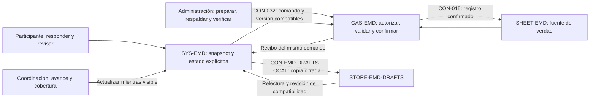

# EMD · contratos de guardado, versión e interacción

Propuesta `CHG-EMD-CONTRATOS-20261102`, autorizada por el propietario el 2 de noviembre de 2026. Estado: propuesta registrada antes de implementar. Componentes: `SYS-EMD`, `GAS-EMD`, `SHEET-EMD` y `STORE-EMD-DRAFTS`; `SYS-YOD-OS` participa únicamente por este atlas.

La revisión independiente del grafo y el contraste posterior con código proponen conservar la plataforma modular actual. Este registro precisa conexiones existentes y sus condiciones de aceptación. No acredita despliegue, fallos en datos humanos ni investigación con participantes. Las reproducciones y detalles técnicos del sistema privado permanecen fuera del atlas público.

## Estructura e interacción propuestas

Las flechas describen responsabilidades y requisitos propuestos sobre conexiones existentes. Los tres recorridos no crean tres roles de autorización nuevos. Identidad, asignaciones y permisos siguen bajo autoridad del backend. Sheets conserva registros canónicos; Drive e integraciones mantienen sus contratos actuales.

| Conexión | Cambio acotado | Condición de aceptación |
| --- | --- | --- |
| SYS-EMD → GAS-EMD → SHEET-EMD | Recibo ligado al comando persistido | Repetición exacta recupera confirmación; contenido diferente no recibe una confirmación equivalente; revisión y cierre terminal conservados |
| Evaluación ↔ instrumento ↔ borrador | Versiones y compatibilidad explícitas | Versión incompatible conserva contenido y bloquea interpretación/restauración/envío automáticos; legado reconocido únicamente por política documentada |
| Artefacto → transporte | Modo demo/operativo y build/contrato identificables | Ausencia de transporte en modo operativo comunica indisponibilidad; no carga muestras ni cambia de modo tras un error |
| Vista → consultas periódicas | Pausa por visibilidad y actualización controlada al volver | Sin consultas periódicas ocultas ni solicitudes solapadas; guardado pendiente conserva su ciclo y confirmación |
| Pregunta → validación → revisión | Error asociado a la pregunta y resumen navegable | Teclado y lector pueden encontrar cada omisión; foco, preguntas y siete etapas se conservan |
| Administración e integraciones → recuperación | Ensayo aislado de interrupciones y conciliación | Respaldo restaurable, reanudación sin duplicados y efectos inciertos conciliados antes de repetirse |

## Contratos e invariantes

- `CTR-EMD-WRITE-RECEIPT`: autorización por objeto, bloqueo, revisión, snapshot inmutable, confirmación del mismo comando y cierre terminal.
- `CTR-EMD-INSTRUMENT-VERSION`: versión del instrumento separada del formato de matriz; evaluación y borrador con compatibilidad explícita. Metadatos nuevos se resuelven por cabecera y se conservan; leer no inicializa ni migra registros.
- `CTR-EMD-RUNTIME-MODE`: intención explícita del artefacto, demo aislada, identificación de build/contrato y transporte operativo obligatorio.
- `CTR-EMD-INTERACTION-RECOVERY`: sondeo condicionado a visibilidad, errores accesibles y ensayos de recuperación sin efectos de negocio.

La implementación privada fijará los nombres y la serialización canónica de campos antes de publicar. Los recibos, la campaña, el instrumento y su compatibilidad deben corresponder en cliente y servidor. Un hash declarado no sustituye validación de autorización ni revisión.

Los registros sin metadatos de versión se tratan como legado explícito. Un instrumento previo solo puede reconocerse mediante una huella literal de la fuente comprobada; no etiquetar retrospectivamente cualquier dato con el instrumento actual. Un borrador legado o incompatible permanece inspeccionable por sus códigos, sin asociarlo silenciosamente a preguntas de otra versión ni eliminarlo. No modificar filas históricas al leerlas.

Se mantienen `CTR-EMD-DRAFTS`, `CTR-EMD-ESCALA-CAPTURA`, `CTR-EMD-GITHUB-EMBED`, el aislamiento de identidad y las reglas de cierre. Se conservan 28 textos/IDs, captura 1..5 y NA históricos conforme al contrato aprobado; no se crean ponderaciones ni resultados agregados. Ningún ensayo autoriza envío de invitaciones, nuevos accesos o cambios de permisos.

## Verificación y orden de entrega

1. Registrar esta propuesta y revisar sus impactos antes de editar comportamiento; la implementación aislada puede comenzar después del registro local.
2. Ejecutar pruebas sintéticas de comando, revisión, autorización, cierre, versiones, legado, restauración, modo, visibilidad y accesibilidad en el repositorio privado. Comprobar importación interrumpida e integración remota incierta sobre dobles o copias aisladas.
3. Validar esquema, referencias y vistas deterministas del atlas; ejecutar los checks del repositorio. Integrar por PR y fijar el commit resultante en el manifiesto/workflow consumidor antes de integrar o publicar EMD.
4. Comparar fuente, configuración, almacén y versión activos; preparar respaldo privado. Publicar en la implementación existente preservando URL y permisos. Cliente y backend deben usar contratos compatibles; un identificador de build no certifica que se publicó.
5. Registrar por separado código integrado, frontend publicado, versión GAS y comprobación de recorrido. La prueba sintética no acredita uso humano, Safari físico ni carga productiva; esas verificaciones siguen pendientes hasta contar con evidencia.

## Reversión

Revertir por PR este registro y regenerar vistas conservando aportes concurrentes. El rollback de EMD restaura solo código compatible: conserva los campos añadidos, respuestas, revisiones, cierres, copias locales y guards vigentes. No borrar o restituir datos de negocio como parte de la reversión. Una versión anterior incapaz de respetar metadatos y guards no es un rollback válido; en ese caso suspender captura afectada hasta preparar parche compatible, manteniendo lectura e historial cuando sea seguro.
