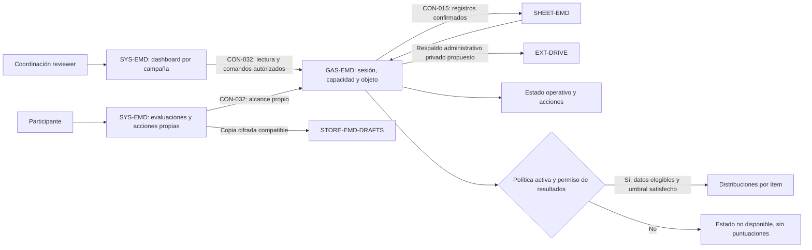

# EMD · dashboard y mejora continua

Propuesta `CHG-EMD-MEJORA-CONTINUA-20261103`, registrada antes de implementar. Revisión `2026-11-03.emd-mejora-continua.1`. La autorización del propietario comprende construir la ampliación; no define por sí sola una metodología oficial de resultados ni concede capacidades a actores concretos.

La base privada integrada es `5fdecaa012e9b8e568c664f4f972c65b2087671d`; el atlas previo es `1d3a9bb3b025cfa3a05916bdd98b24e753db4dc3`. Integración de fuentes no acredita la versión activa de Apps Script. Este registro no modifica el visor Graphify original ni su snapshot anterior.

## Estructura

El sistema conserva `SYS-EMD`, `GAS-EMD`, `SHEET-EMD`, `STORE-EMD-DRAFTS` y `EXT-DRIVE`. `SYS-YOD-OS` participa por el atlas; `SYS-CONTROL` solo consume la proyección documental de su catálogo de procesos. No se alteran monitores, tareas programadas ni reglas de salud. Dashboard, administración, acciones y metodología son módulos lógicos del sistema existente, sin nuevos roles o servicios.

Las conexiones representan el alcance propuesto. Se preservan los estados de evidencia y despliegue anteriores. La arista de respaldo identifica una responsabilidad administrativa sobre Drive existente; no crea almacenamiento público ni un servicio nuevo.

## Facultades y recorridos

La lectura operativa corresponde al reviewer vigente. La autorización de escritura y resultados se resuelve además por actor canónico en el servidor mediante capacidades explícitas: `managePeople`, `manageCampaigns`, `manageActions`, `manageMethod`, `activateMethod` y `viewResults`. Todas permanecen deshabilitadas por defecto. Los controles de pantalla no sustituyen la validación de cada RPC.

El participante recibe exclusivamente sus evaluaciones y acciones. No accede al dashboard global ni a resultados ajenos. Cada operación valida sesión, actor, capacidad cuando aplique y pertenencia del objeto; se rechazan revocación, sesión vencida, contexto incompatible y respuestas tardías de otra sesión o campaña.

| Recorrido | Comportamiento propuesto | Condición verificable |
| --- | --- | --- |
| Dashboard | Campaña, avance, cobertura, acciones y estado metodológico separados | Cada indicador tiene denominador, contexto y fecha; consultar no crea registros ni produce efectos |
| Personas | Gestión autorizada con identidad canónica y referencias estables | Rechazo sin capacidad; sin fusiones inferidas, borrado de historia o emisión automática de accesos |
| Campañas | Preparación, operación, pausa, cierre y archivo explícitos | Estados `draft/open/paused/closed/archived`; transiciones validadas; campaña y EVAL_ID inmutables |
| Acciones | Objetivo, responsable y seguimiento aportados, con persistencia y recibos | Recarga conserva datos; reintento no duplica; conflicto no sobrescribe; alcance propio comprobado |
| Metodología | Borrador versionado y activación separada | `manageMethod` no concede `activateMethod` o `viewResults`; activar exige versión exacta y política completa |
| Resultados | Motor inicial `distribution_v1` bajo política activa | Histogramas 1–5 por ítem, NA/ausentes separados, audiencia/umbral/universo/corte explícitos |

Cerrar una evaluación no cierra la campaña. Una campaña nueva no recicla IDs ni reetiqueta respuestas históricas. Cambiar de campaña mantiene la compatibilidad y revisión de cada evaluación y borrador. La gestión de personas no implica invitación, correo, creación de credenciales o ampliación de permisos de archivos.

## Reglas operativas acordadas

Las campañas legadas se presentan como no gestionadas, sin inventar fechas ni migrar al leer. Adoptarlas es una operación explícita. El plan de cruces conserva IDs y se aplica con hash y revisión de campaña; valida de nuevo, respalda y confirma sólo tras lectura de comprobación. Un lote parcial conserva su plan y recibo para reanudarlo por ID.

La pausa, cierre o archivo bloquean nuevas respuestas, manteniendo la recuperación del recibo exacto de una mutación previamente confirmada si el permiso sigue vigente. El cierre de campaña prepara y verifica un manifiesto privado del corte antes de confirmar el estado. Los pendientes requieren aceptación explícita y no se rellenan automáticamente.

Las acciones tienen estados `open`, `in_progress`, `blocked`, `ready_for_review`, `done` y `cancelled`. El responsable sólo comunica progreso/evidencia, bloqueo o solicitud de revisión; no crea, reasigna, cierra, cancela ni cambia objetivo, plazo o campaña. Coordinación autorizada revisa y cierra o reabre con motivo. El vencimiento se deriva del plazo, sin crear un estado nuevo. El registro canónico es un log privado append-only con postestado completo y recibo; evita una falsa transacción entre tablas de estado e historia.

Las lecturas operativas son paginadas, ordenadas por ID y ligadas a filtros/campaña/revisión. Si cambia la revisión, se reinicia la paginación mediante conflicto; no se combinan páginas de distintos cortes. El panel de operación distingue configuración presente, lectura comprobada, indisponibilidad, fallo y comprobación pendiente, con fecha y alcance. Las identidades QA se rechazan en entidades reales o usan un almacén completamente aislado.

## Política inicial de resultados

No se ha aportado una regla oficial. La configuración inicial será un borrador vacío, sin activación ni cálculo real. El dashboard operativo puede mostrar cobertura y acciones aunque no exista una política activa, pero presenta resultados como no disponibles.

El primer motor es únicamente `distribution_v1`: histograma de respuestas 1–5 y porcentajes sobre respuestas numéricas elegibles por ítem, con NA y ausentes separados. Sólo se consideran evaluaciones cerradas elegibles en un corte fijo; se declara el número de evaluadores independientes además del número de respuestas. No se añaden ponderaciones, promedio global, ranking, percentiles, brechas ni metas inferidas. El método debe declarar elegibilidad, campaña, instrumento, corte, audiencia, tratamiento de ausencias y umbral de confidencialidad antes de activarse.

La activación conserva una versión inmutable. Los resultados quedan vinculados a esa versión y a su universo; una modificación requiere otra versión y no cambia silenciosamente los históricos. El servidor aplica permisos y supresión antes de devolver datos: filtros y subtotales no pueden eludir el umbral. La explicación de no disponibilidad no revela valores suprimidos. El umbral se mide por evaluadores independientes por celda, no por número de preguntas. Relaciones, tratamiento de autoevaluación y agrupación se seleccionan explícitamente; la agrupación inicial permite persona evaluada y grupo de relaciones fijado por política, sin filtros arbitrarios.

Cada informe usa una copia privada de los datos elegibles o un agregado materializado con fuente fijada. No reconstruye cortes anteriores a partir de datos cambiantes o de la última actualización. Sin comparabilidad comprobada de instrumento, método y denominadores, se muestran cortes separados; no se dibujan curvas de mejora.

## Persistencia, operación y recuperación

Los registros canónicos permanecen en Sheets privado; las copias locales siguen cifradas y nunca acreditan confirmación del servidor. Administración, acciones y métodos mantienen IDs estables, revisión optimista, comandos ligados al contenido, recibos e historial. Las nuevas tablas o columnas son aditivas y se crean solo mediante una operación autorizada; las lecturas no inicializan ni migran datos.

Los cambios administrativos que requieran respaldo lo realizan privadamente antes de la escritura, con validación previa y recuperación definida. Restaurar un respaldo no debe borrar cambios posteriores. Un error parcial o un recibo incierto se concilia antes de repetir efectos.

No se añaden triggers, cron, rondas, recordatorios automáticos ni envíos como parte de este registro. La continuidad consiste en conservar campañas y seguimiento, y actualizar vistas de manera controlada cuando están visibles. Las acciones y los estados declarados no demuestran por sí solos mejora causal, entrega de invitaciones o cumplimiento observado.

## Contratos y aceptación

El modelo incorpora `CTR-EMD-CONTINUOUS-DASHBOARD`, `CTR-EMD-CONTINUOUS-ADMIN`, `CTR-EMD-IMPROVEMENT-ACTIONS` y `CTR-EMD-VERSIONED-RESULTS-POLICY`, sobre `CON-032`, `CON-015` y la compatibilidad de `CON-EMD-DRAFTS-LOCAL`. El contrato privado coordinado `continuous-v1` fija campos y RPC: transporte versionado, DTO acotados, capacidades de `getAccess`, lecturas sin efectos, comandos con revisión/mutación/digest y recibos que el frontend coteja. Las capacidades se calculan por actor canónico; ninguna credencial se guarda en texto claro en el navegador. Los detalles operativos permanecen en el repositorio privado.

Pruebas previstas:

1. Autorización positiva y negativa por sesión, actor, capacidad, objeto y campaña; segregación participante/reviewer y callbacks tardíos.
2. Creación y gestión sintéticas de personas/campañas; IDs estables, transiciones inválidas, revisiones y reintentos, con históricos intactos.
3. Acciones persistentes y revisión de seguimiento; confirmación exacta, conflicto e interrupción sin duplicación ni estado de cumplimiento fabricado.
4. Política vacía/incompleta no activa ni calcula; capacidad de activación separada; versiones, elegibilidad, NA/ausencias, umbral y supresión probados con datos sintéticos.
5. Interfaz móvil/escritorio y teclado; filtros y datos confirmados, estados de espera/error y recuperación comprensibles; regresiones del cuestionario y del handshake vigentes.
6. Esquema, referencias, vistas deterministas e impacto del atlas; suites del consumidor antes de integrar. Investigación con personas, carga real, permisos vivos y despliegue requieren evidencia adicional.

## Entrega y reversión

El registro local permite comenzar implementación aislada dentro del contrato coordinado. Root revisará propuesta y contrato antes de autorizar push/merge de esta ampliación. La entrega posterior requerirá PR, checks, commit de atlas fijado en el consumidor y publicación del Apps Script existente con respaldo y comparación de la versión activa. Este registro no publica la aplicación ni activa capacidades o políticas.

Revertir el PR documental y regenerar vistas preservando aportes concurrentes. La reversión funcional usa una versión compatible y conserva personas, campañas, acciones, eventos, políticas, respuestas, revisiones, cierres y borradores. No borrar campos nuevos ni restaurar respaldos encima de cambios posteriores. Si una versión previa no conserva los controles necesarios, desactivar la capacidad o captura afectada hasta preparar un parche compatible.
