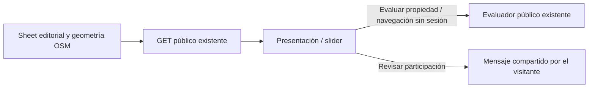

# Presentación comercial y entrada al evaluador

Dirección autoriza revisar el recorrido existente con propuesta Franco y lenguaje YoDesarrollo.

La cartografía acredita geometría vial, no demanda ni zonificación. El esquema de unidades no acredita cabida. El evaluador inicia filtro observable, no dictamen. No cambia guardado, permisos ni datos de proyectos.

Estado: propuesta previa a implementación; verificación de publicación se registra separadamente.
