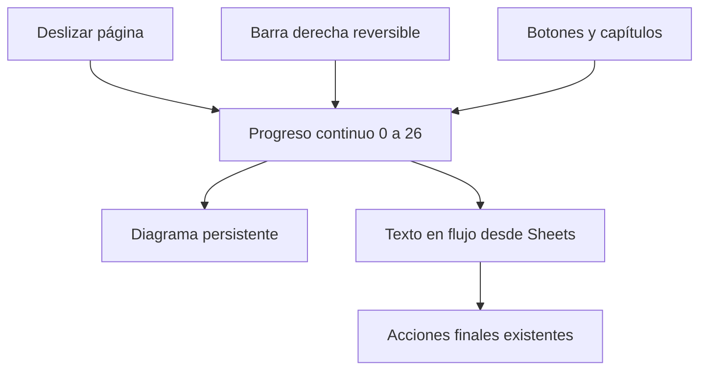

# Recorrido móvil de inversión

Registro previo. Misma URL, copy desde Sheets y diagrama persistente. Lectura nativa, sin secuestrar gestos ni bloquear el zoom.

Cada momento dispone de recorrido largo para leer. Barra derecha con objetivo táctil de 44 px, controles inferiores y zonas seguras. Sin autoplay. Reducir movimiento elimina interpolaciones. Orientación y escritorio conservan el momento. Validación con WebKit emulado y Chromium; no equivale a prueba física de iPhone.
