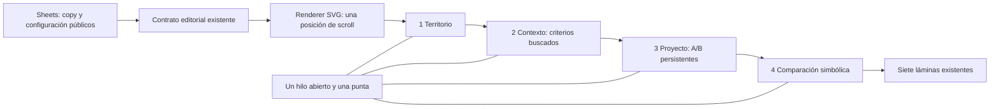

# Apertura ilustrada por scroll

Propuesta CHG-INVESTOR-ORANGE-THREAD, autorizada por Dirección. Estado: propuesto; no acredita despliegue.

El hilo es un objeto visual; no es GPS ni certifica una selección. Casas y símbolos de valor son magnitudes distintas. La fuente editorial conserva todo el contenido; Git contiene renderer genérico y pruebas sintéticas. Pausa, navegación y scroll comparten progreso. Retroceder reconstruye el estado sin escribir datos. Modo reducido permite cambiar escenas sin vuelo. Las cuentas nunca tapan los modelos. La hoja y la presentación existente no se duplican.

Verificación requerida: tip sobre curva; cantidades de casas iguales a configuración; contornos y A/B estables; DOM persistente; lectura 320/390/1440; controles y continuidad a las siete láminas. Código revisado, navegador sintético y producción se registran por separado. Reversión por PR del frontend conserva Sheets, permisos y expedientes.
