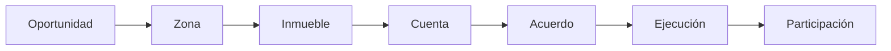

# Presentación simplificada · siete escenas

Estado: propuesta aprobada por Dirección, registro previo a implementación. CHG-INVESTOR-SIMPLE-STORY; 2026-10-13.investor-simple-story.1. No acredita conversión ni producción.

El nuevo frontend se crea desde cero: siete cuadros independientes, hasta tres revelados por cuadro, trazos de6px o mayores, tipografía de palo seco y amplio espacio. La escena anterior se limpia; no existe cámara mundial ni una punta constante. Reemplaza la entrada en la misma URL; la principal anterior y beta quedan archivadas dentro de ella.

A/B/C siguen siendo zonas; las propiedades se comparan después. La cuenta considera inversión completa y condiciones adversas, no un ganador ni retorno garantizado. Revisión y acuerdo preceden al compromiso/desarrollo; proyecto y permisos preceden a obra; documentación, venta y cobros preceden a reparto según acuerdo. Participación con capital o inmueble, coordinación YoDesarrollo.

simple_version/simple_config viven en el mismo Sheet editorial. Todos los titulares, frases, etiquetas, controles y detalles se leen por el GET público existente. El lector conserva íntegros los bloques previos, criterios, notas y mensajes. Código sólo contiene geometría conceptual y fixtures sintéticos. No se copian datos privados ni se modifican backend, identidad, precios o reglas comerciales.

Pruebas: contratos de geometría/seguridad; Chromium320/390/1440 con controles, scroll/reversa, reduced-motion, lectura completa, archivo anterior, fuente viva y cero escrituras. Publicación anónima se comprueba por separado contra los archivos exactos y captura real.

Rollback: revertir sólo frontend; mantener todas las filas editoriales, archivos originales y datos de negocio. No crear otra presentación ni sitio.
