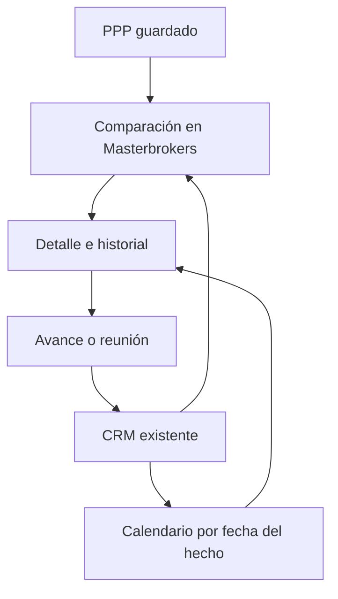
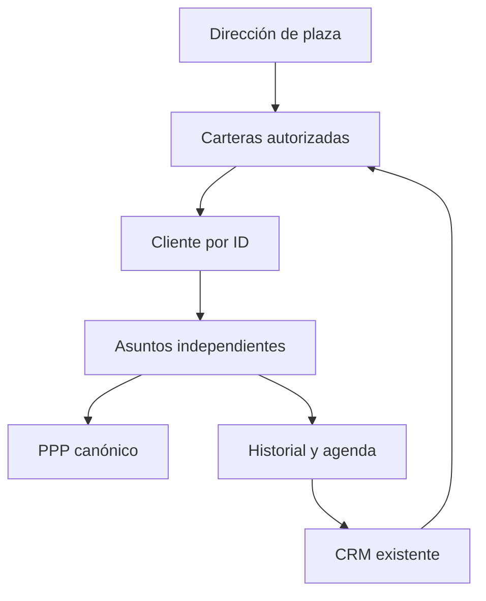

# Masterbrokers · Mini CRM

Una barra por expediente, varios abiertos para comparar. El detalle combina el PPP real en lectura y el historial con calendario. Reutiliza BROKERS_Actividades y el contrato brokers.v1, sin una segunda base.

La nota lleva un sobre versionado de metadatos. Se conservan los nueve campos nativos de actividades y todas las notas previas. La fecha del hecho es independiente de la captura del servidor. La programación sólo se cierra con un registro explícito y conserva el historial original.

El resumen del PPP muestra sus inputs/resultados guardados, versión y fecha. Las otras versiones se nombran; no se calcula un rendimiento fuera del PPP. Propietario y participantes requieren evidencia explícita.

Documentos aportados pueden alimentar el historial con clave estable y origen verificable. Una lectura o clic no representa avance comercial; no se presume escucha en WhatsApp, transcripción de nuevas grabaciones ni invitación en Google Calendar.

Verificaciones previstas: codec/legado, días en Hermosillo, duplicados y reemplazos, permiso/sesión, PPP sin motor, varios desplegables y navegador320/390/1440. Revertir sólo frontend; preservar registros operativos.

## Dirección y carteras · 17-oct

Entrada de Dirección por plaza y responsables; navegación a clientes y asuntos sin cambiar el actor autenticado. La tarjeta propia sólo se ordena por coincidencia única de nombre o referencia explícita del actor; no habilita identidades ni permisos. La etiqueta territorial no reemplaza las ACL del backend.

Contactos homónimos no se fusionan. Un asunto sin contacto conserva su ID y muestra pendiente de vincular. Un cliente con varios terrenos mantiene una fila de cliente y expedientes separados. El responsable nominal usa el campo next_action vigente; las asignaciones genéricas antiguas no se reinterpretan. notes conserva texto previo y metadatos YOD-CASE-v1 para estado PPP y decisión solicitada. No se actualiza estado comercial al registrar una actividad.

Los accesos individuales inactivos siguen inactivos. Las pruebas usan datos sintéticos y no crean seguimientos ficticios en producción. Lectura privada, integración, publicación y aceptación se registran por separado.
