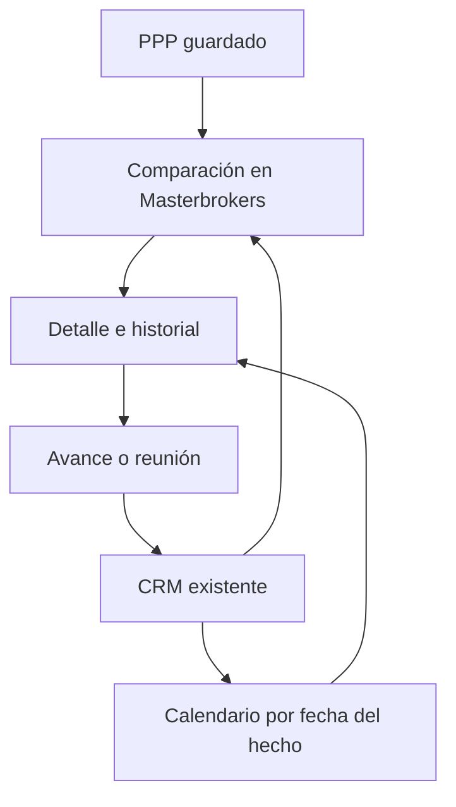
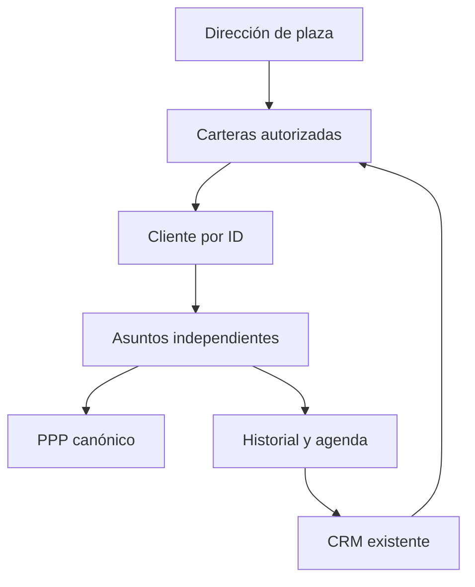
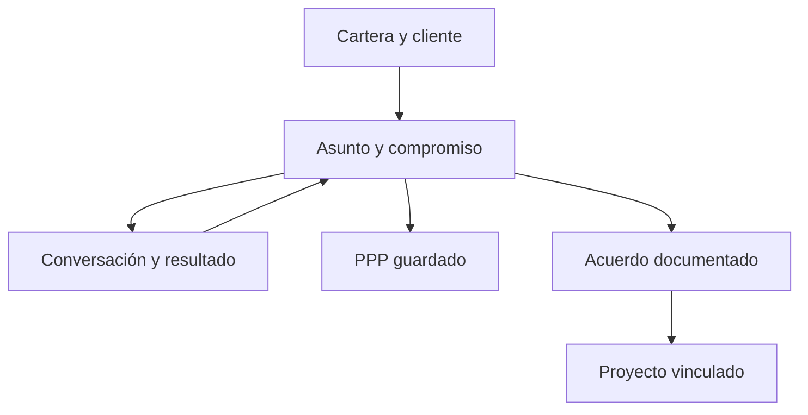

# Masterbrokers · Mini CRM

Una barra por expediente, varios abiertos para comparar. El detalle combina el PPP real en lectura y el historial con calendario. Reutiliza BROKERS_Actividades y el contrato brokers.v1, sin una segunda base.

La nota lleva un sobre versionado de metadatos. Se conservan los nueve campos nativos de actividades y todas las notas previas. La fecha del hecho es independiente de la captura del servidor. La programación sólo se cierra con un registro explícito y conserva el historial original.

El resumen del PPP muestra sus inputs/resultados guardados, versión y fecha. Las otras versiones se nombran; no se calcula un rendimiento fuera del PPP. Propietario y participantes requieren evidencia explícita.

Documentos aportados pueden alimentar el historial con clave estable y origen verificable. Una lectura o clic no representa avance comercial; no se presume escucha en WhatsApp, transcripción de nuevas grabaciones ni invitación en Google Calendar.

Verificaciones previstas: codec/legado, días en Hermosillo, duplicados y reemplazos, permiso/sesión, PPP sin motor, varios desplegables y navegador320/390/1440. Revertir sólo frontend; preservar registros operativos.

## Dirección y carteras · 17-oct

Entrada de Dirección por plaza y responsables; navegación a clientes y asuntos sin cambiar el actor autenticado. La tarjeta propia sólo se ordena por coincidencia única de nombre o referencia explícita del actor; no habilita identidades ni permisos. La etiqueta territorial no reemplaza las ACL del backend.

Contactos homónimos no se fusionan. Un asunto sin contacto conserva su ID y muestra pendiente de vincular. Un cliente con varios terrenos mantiene una fila de cliente y expedientes separados. El responsable nominal usa el campo next_action vigente; las asignaciones genéricas antiguas no se reinterpretan. notes conserva texto previo y metadatos YOD-CASE-v1 para estado PPP y decisión solicitada. No se actualiza estado comercial al registrar una actividad.

Los accesos individuales inactivos siguen inactivos. Las pruebas usan datos sintéticos y no crean seguimientos ficticios en producción. Lectura privada, integración, publicación y aceptación se registran por separado.

## Refinamiento de experiencia · 17-oct

El inicio canónico presenta al Master Developer, su cartera y los responsables desplegables con sus asuntos. Cada expediente hace visible el enlace al PPP y separa historia, situación actual y siguiente paso. Los enlaces explícitos a una cartera conservan su alcance y ofrecen regreso a Mi portal. La activación por correo sigue siendo una operación separada; un perfil de cartera no es una identidad habilitada. Conversaciones autorizadas pueden importarse manualmente con fecha, fuente y clave de deduplicación, sin inventar una sincronización continua.

## Espacio de trabajo unificado · corrección17-oct

La revisión anterior fue rechazada por redundancia. Se sustituye la portada y sus métricas por una única lista de trabajo dentro de la identidad Master Developer. Selector de alcance: equipo, cartera propia y brokers autorizados. No son portales distintos ni cambios de identidad. Cada cliente conserva sus asuntos independientes, próximos compromisos y responsables. Abrir un asunto conserva la lista en escritorio; móvil ofrece regreso claro. Contactos sin asunto, filtros, calendario y material son secundarios.

Las conexiones son referencias del expediente: no se presume sincronización transaccional, contrato aceptado, viabilidad, titularidad ni proyecto aprobado. PPP y operación conservan sus fuentes; el CRM registra relación, evidencia y siguiente gestión. Sin enlace, la pantalla muestra el pendiente y permite completar la referencia bajo los permisos existentes.

Criterios aplicados al diseño: claridad de la oferta y menor esfuerzo para entender el siguiente paso (marco de valor de Acquisition.com); continuidad de seguimiento con CRM (Grant Cardone); información progresiva y contexto conservado (Nielsen Norman Group). No se incorporan técnicas de presión, promesas de rentabilidad ni automatizaciones de contacto. Referencias: https://www.acquisition.com/training/offers4 ; https://grantcardone.com/sales-prospecting-guide/ ; https://www.nngroup.com/articles/complex-application-design/ .

Prueba: inicio MD sin broker preseleccionado, cartera propia separada, acceso individual aislado, cliente con varios terrenos, guardar/releer, fuentes/calendario, PPP sin recálculo, ausencia de overflow320/390/1440. Reversión sólo frontend: datos, perfiles, contratos y actividades intactos.

## Muestra pública en GitHub Pages · 18-oct-2026

CHG-MASTERBROKERS-PUBLIC-PREVIEW registra la petición de abrir el prototipo sin cuenta. La ruta `yodesarrollo-board/master-brokers/` sirve HTML, CSS y módulos estáticos con ejemplos ficticios. Entrada: Master Developer y su equipo; cada cartera permite recorrer prospecto → trabajos → historial / PPP de ejemplo.

Esta ruta no incorpora Portero, shell autenticado, datos privados ni conectores. La indicación de muestra permanece visible; no implica que los expedientes o los cálculos PPP estén conectados. `brokers.html` y su contrato productivo siguen independientes. No se modifica el catálogo global ni se activa acceso de un broker.

Pruebas: referencias y filtros; recorrido anónimo en escritorio y móvil; enlaces profundos, historial y PPP; ausencia de llamadas de negocio y verificación de archivos publicados. Reversión: retirar sólo la muestra pública, sin restaurar registros operativos.
