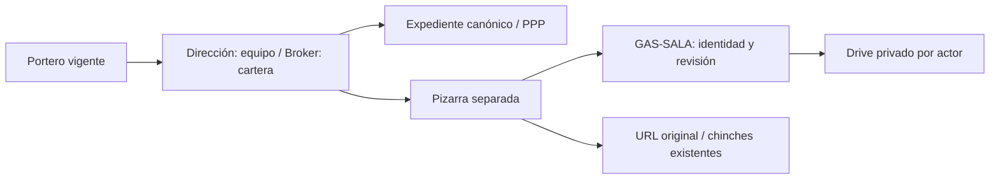

# Master Developer y pizarra personal

Nombre Master Developer para Dirección y Master Broker para otras cuentas autorizadas; entrada por brokers y recorrido canónico por proyecto. Pizarra separada con carátulas, posición, zoom, montones, carpetas, búsqueda y deshacer. Estado personal privado por actor verificado en GAS-SALA existente, revisión esperada y recibo idempotente. Conservar CRM, IDs, fuentes, permisos, versiones, chinches y URLs; no inferir avance comercial del tipo de oportunidad.

## Flujo

## Invariantes

La organización visual no modifica el catálogo, vínculos, contenido ni condiciones comerciales. Cada cuenta conserva exclusivamente su organización; las lecturas no crean archivos. Los cambios se guardan con revisión y recibo. Un conflicto conserva el borrador y exige conciliación explícita. Las pruebas usan datos sintéticos.
