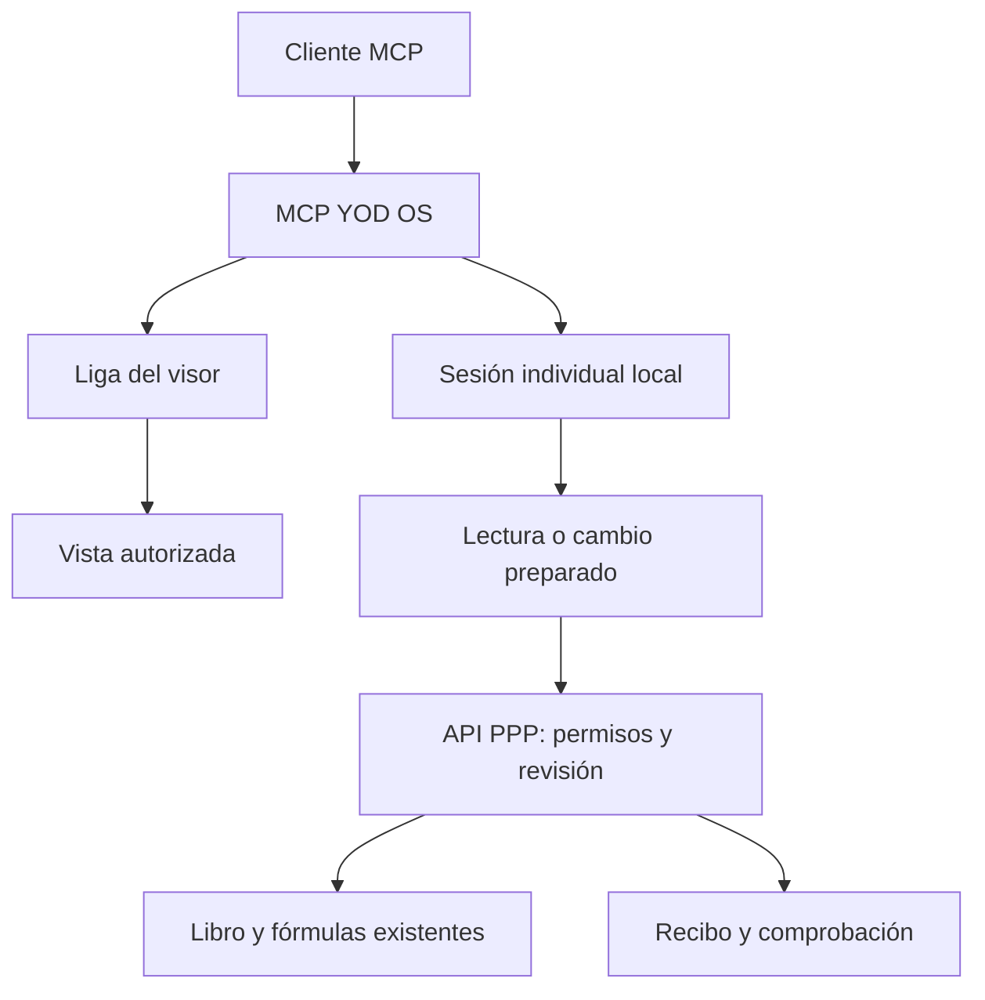

# MCP YOD OS · primer adaptador PPP

Dirección autorizó el 15 de noviembre de 2026 terminar una puerta interoperable
para consultar y alimentar YOD. `CHG-YOD-MCP-20261115` implementa esa puerta en
`potenciales-yod/mcp/`, utilizando los contratos del PPP ya existentes.

| Capa | Responsabilidad |
|---|---|
| SDK MCP | Descubrir herramientas, recurso de contrato y prompt; stdio y Streamable HTTP |
| Adaptador PPP | Validar entrada, fuentes/unidades, alcance y propuesta de cambio |
| Portero y API PPP | Identidad, autorización, revisión y operación de negocio |
| Libro actual | Fórmulas, datos y bitácora canónicos |
| Diario privado MCP | Evitar reenvíos del mismo cambio y conservar recibos ante fallos |

El transporte público sólo lee ligas autorizadas o entradas publicadas
explícitamente. Su catálogo arranca vacío. El transporte local puede usar una
sesión individual para consultar y editar PPP2 por API. Nunca escribe directamente
en Sheets ni usa una llave maestra. No existe todavía OAuth multiusuario remoto.

La propuesta conserva antes/después, revisión, huella y caducidad de 15 minutos.
Aplicar comprueba todo de nuevo; el recibo separa preparado, enviado, rechazado,
incierto, aplicado y verificado. Resultado incierto no se reenvía automáticamente.
No se aprueban versiones vigentes ni se disparan rondas de IA. La cadena de
confirmación identifica la propuesta; no sustituye el encargo autorizado.

Estado al registrar: código implementado y probado en rama con el servidor PPP
real ejecutado sobre datos sintéticos. Despliegue HTTP, lectura con una liga real
y conexión de cada cliente se acreditan por separado. Las fórmulas y Apps Script
existentes no se modifican. Los trabajos concurrentes del visor permanecen en sus
ramas y no se incluyen en este cambio.

Validación: protocolo real mediante SDK, stdio, HTTP, permisos, revocación,
concurrencia, huella, pérdida de respuesta y repetición después de reiniciar.
También regresiones PPP, atlas, cobertura y verificadores del portal.
No se usan escrituras de producción como prueba.

Reversión: parar el servicio MCP y retirar la conexión del cliente. Conservar
recibos privados; no restaurar ni borrar libros. El motor PPP sigue funcionando.

Extensión: cada nuevo adaptador declara entidades, unidades, reglas, permisos,
fuentes, pruebas y recibos. Obra, fotos, pagos, CRM y Sala requieren adaptadores
propios. La compatibilidad MCP no es una certificación ISO ni valida los supuestos
financieros de un proyecto.

Contrato operativo, instalación y ejemplos:
[potenciales-yod/mcp](https://github.com/yodesarrollomx/potenciales-yod/tree/main/mcp).
