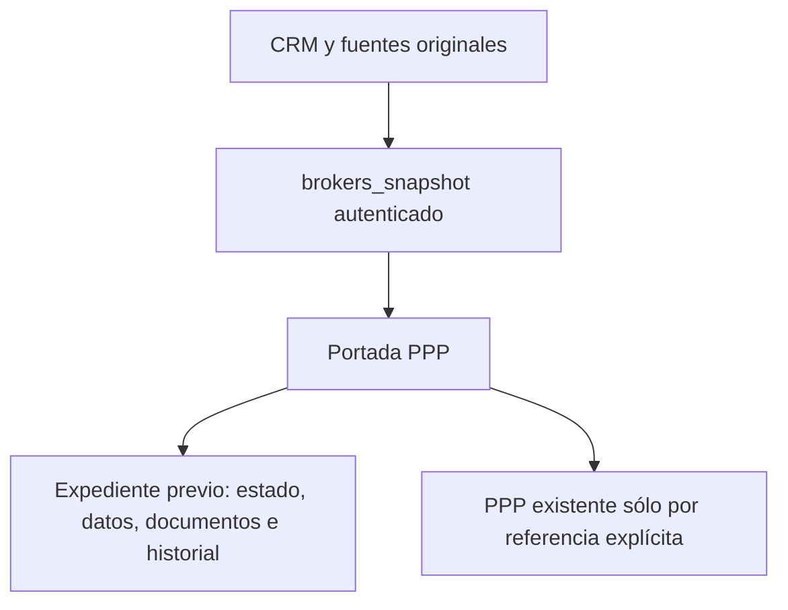

# Expedientes previos al PPP en la portada

La ausencia de una corrida financiera no debe ocultar un expediente ya documentado. La portada consume el snapshot privado `brokers.v1` mediante `brokers_snapshot` del servicio existente. Es una lectura; no llama `brokers_save`, no crea modelos, no instala backend y no amplía permisos.

El backend filtra por actor. El lector valida contrato y pertenencia, conserva la identidad vigente, descarta respuestas tardías y no persiste el snapshot. Rechazo de acceso muestra indisponibilidad sin recurrir a datos antiguos o públicos. El endpoint público es configuración observada del consumidor Masterbrokers; no contiene credenciales.

Un expediente sin `ppp_id` se muestra como análisis previo. Cuando hay una referencia explícita se conserva el caso existente y se añade contexto, sin copiar resultados financieros. El orden cronológico usa la fecha del hecho del sobre YOD-CRM-v1; la captura y la última revisión son datos separados. Un borrador recibido no es contratación ni decisión aceptada. Datos y fuentes privadas permanecen en sus libros y notas.

Conciliación documental autorizada: añadir checkpoint por fuente/fecha/ID en el registro original; preservar historia, propuestas rechazadas y condiciones pendientes. No inferir sincronización de Obsidian local por editar su copia en Drive. Los contenidos originales y las revisiones son la autoridad.

Pruebas previstas: ACL, broker aislado, referencias explícitas, sesión cambiada, texto malicioso, timeout/error/vacío, varias alternativas y UI 320/390/1280. Publicación y lectura real se acreditan por separado. Reversión sólo del lector, sin restaurar registros de negocio.
