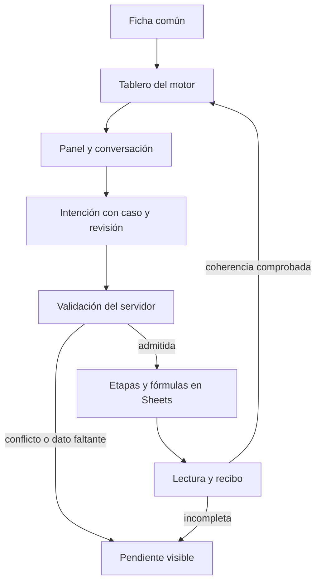

# PPP · ficha común y etapas conversadas

CHG-PPP-FICHA-ETAPAS-20261029 · revisión `2026-10-29.ppp-ficha-etapas.1`.

## Autorización y alcance

Dirección solicita trabajar en el PPP real: una ficha mínima común para los cinco motores, apertura de su tablero normal, paneles que se abren al tocarlos, una etapa inicial y una instrucción por voz, dictado o texto como «3 etapas de 12 meses». El agente debe reorganizar los datos y su calendario en Sheets y comprobar la coherencia tras cada modificación. La entrega debe quedar visible mediante el flujo GitHub existente. Esta autorización cubre el trabajo descrito; no depende de aprobar otra propuesta comercial del atlas.

La superficie es `potenciales-yod`: `mixto.html` (Vertical), `macrolotes.html`, `unifamiliar.html`, `residencial.html` y `patrimonial.html`. La ficha y las etapas forman parte de esos tableros y conservan sus accesos, escenarios, paneles, documentos y enlaces. No se crea un sistema paralelo de demostración ni otro destino de producción.

## Estado al registrar la propuesta

El atlas y `ARQUITECTURA-SHEETS.md` distinguen libros nativos habilitados de casos o motores pendientes de migrar. Hay contratos de Store/puente, escritura autorizada, revisión y recibo; el contrato de volúmenes no acredita por sí mismo edición de etapas. Las comprobaciones históricas de un piloto no cubren los cinco motores.

Esta revisión registra **propuesta autorizada** antes de implementación. No acredita todavía alta común, escritura conversada de etapas, paridad financiera de todos los motores, despliegue GAS, publicación Pages ni micrófono físico. Cada estado requiere su propia evidencia.

## Recorrido y fuentes

1. La ficha reúne los datos mínimos exigidos por la plantilla del motor elegido. Los campos comunes conservan significado y unidad; un faltante permanece pendiente y no se convierte en cero. La ficha sólo introduce valores predeterminados estructurales, sin completar cantidades o supuestos financieros. Los supuestos adicionales necesarios se presentan desde el contrato real de la plantilla.
2. Crear o abrir conserva `caso_id` y `escenario_id` y llega al tablero normal de ese motor. Una nueva alta parte de una etapa según su plantilla validada. Abrir un caso existente conserva sus etapas e históricos.
3. Los paneles visibles permiten editar los mismos datos canónicos. La conversación recibe el caso, escenario y revisión observados y el texto final enviado por la persona. Un borrador de voz no ejecuta cambios.
4. El agente traduce la intención a un plan estructurado; no acepta fórmulas o rangos libres como instrucciones de escritura. «3 etapas de 12 meses» debe resultar en tres etapas sucesivas de duración doce, con inicio, orden y horizonte explícitos, respetando el calendario y las restricciones del modelo. El plan debe identificar cualquier dato que todavía no pueda determinarse.
5. El escritor autorizado aplica el cambio al libro del mismo caso/escenario mediante el contrato vigente. Sheets conserva y evalúa las fórmulas; los consumidores validan y presentan. La lectura posterior devuelve revisión, entradas, resultados, calendario, validaciones y recibo de la operación.
6. El tablero y la conversación muestran el mismo estado confirmado. Un fallo o conflicto conserva el último confirmado y el pendiente con una explicación; nunca anuncia que quedó guardado sólo porque se actualizó el DOM.



## Contrato de transporte previsto

La ampliación se prepara en `server/PPPStages.gs` y `server/PPPStagesProgram.gs`, integrada en la ruta `sheet-stages` del Portero existente. El sobre conserva la autenticación vigente e incluye los siguientes campos de negocio; el ejemplo es sintético:

```json
{
  "caso_id": "CASO-SINTETICO",
  "escenario_id": "ESCENARIO-SINTETICO",
  "revision_esperada": "REVISION-BASE",
  "request_id": "OPERACION-SINTETICA",
  "stages": {
    "schema": 1,
    "count": 3,
    "duration_months": 12,
    "mode": "sequential",
    "allocation": "preserve"
  }
}
```

`mode: sequential` declara etapas sucesivas. `allocation: preserve` conserva las asignaciones canónicas del modelo; no permite inferir un reparto uniforme ni multiplicar los importes por `count`. Etapas y volúmenes son colecciones distintas: el cambio de calendario no modifica la colección schema2 de volúmenes ni su método de recursos comunes.

La lectura nativa incorpora `stages_by_scenario`; la confirmación usa `stage_receipt.calculated` y sus `checks`, ligados a la misma operación y lectura. Una capacidad ausente o un resultado no calculado conserva el estado pendiente. La existencia de estos nombres en la propuesta o fuente preparada no demuestra que el host activo atienda la ruta ni que los cinco libros soporten el cálculo. Deben contrastarse fuente/host activos, capacidades y readback antes de declararlo funcional.

## Invariantes

- Se conserva `CTR-PPP-SHEETS`: libro canónico por caso, escenarios e IDs estables, datos y fórmulas nativas en Sheets. No se introduce otro cálculo financiero en navegador, agente o Apps Script.
- Los cinco motores comparten la ficha y el recorrido; las capacidades de cada plantilla determinan qué puede persistirse. La interfaz no declara soporte de escritura por el solo nombre del motor.
- Una etapa inicial se aplica a nuevas altas compatibles. No reduce etapas, cuerpos, recursos ni escenarios de un caso existente.
- Autorización de caso/escenario, actor real, revisión esperada y operación idempotente se verifican en servidor. El contexto del chat, una capability del navegador o el menú no conceden permisos.
- Cada cambio conserva antes/después, intención, fuente, versión de modelo, revisión base, identificador de operación y validación. Las operaciones inciertas se concilian por su identidad; un timeout no autoriza enviar otra creación ni repetir la escritura con otro ID.
- Cada modificación contrasta áreas e inventario, asignaciones, calendario completo, recursos comunes una sola vez y resultados/flujos del mismo modelo. La ausencia de evidencia es pendiente, nunca un resultado favorable.
- Una reorganización del calendario no multiplica por el número de etapas el terreno, inventario, ventas, rentas, costos o recursos globales. Las reglas de distribución son las fórmulas nativas autorizadas del motor.
- Las fórmulas protegidas sólo se cambian mediante una migración autorizada y auditable, con texto anterior/nuevo, motivo, versión y pruebas aisladas. La conversación no ejecuta código ni fórmulas arbitrarias.
- Se conservan Portero, códigos, URL, scopes y ACL existentes. No se usa un endpoint de producción para probar escrituras.

## Criterios de aceptación · revisión 1

Todos derivan del encargo de Dirección del 29-oct-2026 y de los contratos existentes. La columna de evidencia identifica qué debe probarse, no una prueba ya concluida.

| ID | Criterio | Evidencia requerida | Resultado esperado |
| --- | --- | --- | --- |
| FICHA-5 | Ficha común en los cinco motores | Recorrido de cada HTML con entradas sintéticas y respuesta real del contrato simulado | Abre el tablero correspondiente, conserva identidad y rechaza los faltantes obligatorios |
| PANEL | Paneles existentes clicables | Escritorio y móvil; teclado y cierre del panel | El control presenta el dato canónico y conserva navegación/documentos/versiones |
| ETAPA-1 | Inicio de un caso nuevo | Fixture nueva de cada plantilla habilitada y reapertura de caso existente | Nuevo con una etapa; existente sin reducción de etapas o históricos |
| INTENCION-3X12 | Una intención para texto, dictado y voz | Texto final «3 etapas de 12 meses», negación, entrada incompleta y audio provisional | Tres duraciones de doce con calendario explícito; no aplica provisional ni interpreta negación como orden |
| COHERENCIA | Verificación tras cada modificación | Fixtures por motor y copia aislada con fórmulas nativas cuando corresponda | Inventario, áreas, recursos, horizonte y flujos concilian; no hay cálculo financiero paralelo |
| CONCURRENCIA | Una escritura por operación autorizada | Revisión obsoleta, cambio de usuario/caso, revocación, duplicado y ACK perdido | Rechazo o conciliación sin sobrescritura ni duplicación |
| CONFIRMADO | Recibo y modelo corresponden | Misma operación, actor, caso, escenario, revisión y lectura posterior | Tablero y agente muestran la misma confirmación o el pendiente exacto |
| ENTREGA | Cambio visible en GitHub y entorno real | PR/commit, CI, Pages, versión existente de GAS y lectura final por separado | Cada capa se acredita sólo por su recibo; no se confunde fuente publicada con backend activo |

## Despliegue y reversión

Registrar primero esta propuesta y el modelo central. La implementación debe fijar el commit de ese atlas en el workflow consumidor. Publicar consumidores compatibles antes de habilitar capacidades nuevas, conservar el flujo de PR y verificaciones de cada repositorio y comprobar frontend, backend y libros por separado. La autorización de esta entrega no cambia reglas comerciales de precios, rendimientos o asignaciones.

Reversión: deshabilitar sólo la capacidad nueva de etapas si es necesario, revertir los commits de interfaz/handler y volver a la versión anterior de la misma implementación GAS. Conservar caso, escenarios, etapas persistidas, recibos, fórmulas, permisos e históricos. Si hubo una migración de fórmulas, su reversión requiere el registro y la conciliación específicos; no restaurar libros completos ni borrar registros a ciegas.

## Evidencia de preparación

Fuentes leídas: `AGENTS.md`, `CLAUDE.md`, atlas/modelo central, `ARQUITECTURA-SHEETS.md` y contrato de volúmenes. Jev reutilizó el triaje del encargo (GitHub; alternativa Drive) y ordenó nueve pasajes con umbral cero, conservando los nueve. La selección priorizó el contrato de Sheets y el transporte nativo; la revisión del agente determinó invariantes y criterios. No es evidencia de ejecución del producto.
