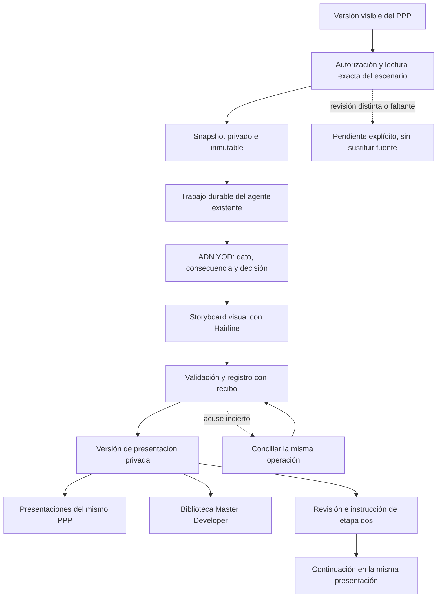

# PPP · Presentaciones desde la versión visible

CHG-PPP-PRESENTACIONES-20261031 · revisión `2026-10-31.ppp-presentaciones.1` · contrato `CTR-PPP-PRESENTACIONES`.

## Autorización y estado

Dirección autorizó ejecutar en equipo el plan para generar presentaciones desde cualquier Plan de Potencial y conservar sus versiones dentro del mismo PPP. Esta autorización de implementación se registró el 31-oct-2026. La propuesta queda **autorizada por chat y registrada antes de implementación**; esta ficha no acredita servicio habilitado, versión de Apps Script, publicación Pages, trabajo productivo ni aceptación editorial.

El botón es **«Mandar hacer presentación con estos números»** en los cinco motores existentes: Vertical, Macrolotes, Residencial, Unifamiliar y Patrimonial. La presentación se adapta al modelo y sus datos disponibles. PPP, expediente, servicio de agentes y catálogo de Master Developer conservan su identidad y sus almacenes actuales; no se crea un backend, libro, cron, catálogo ni motor financiero paralelo.

## Flujo y fuentes de verdad

- **Modelo y resultados:** libro canónico del caso en `SHEET-PPP-MODELOS`, leído mediante `GAS-PORTERO` y su contrato nativo. Un campo capturado no demuestra que el modelo esté calculado. Los casos sin capacidad suficiente producen diagnóstico y pendientes; no utilidades, caja o retornos inventados.
- **Expediente e identidad:** contexto autorizado del caso y actor vigente, con revisión propia. El servidor comprueba que expediente y caso PPP se correspondan. El navegador no decide permisos mediante `case_id`, rol, menú o una capability autodeclarada.
- **Trabajo y recuperación:** `SVC-AUTON-CLOUD` y `STORE-AUTON-ESTADO` existentes. La observación efímera del tablero no reemplaza el snapshot duradero.
- **Presentación e historial:** registro privado de presentaciones atendido por `GAS-SALA`, con archivos privados de control ya definidos por `CTR-PRESENTACIONES-MD-V1`. La vista PPP y Master Developer consultan el mismo registro; no duplican la biblioteca. La relación histórica con `SHEET-SALA` se conserva, sin exigir un libro nuevo.
- **Dibujo:** código genérico de `yodesarrollo-board`, Hairline y adaptador declarativo de escenas. Hairline dibuja; no calcula el negocio ni selecciona por sí mismo la narrativa.

## Contrato del contexto

Los nombres siguientes fijan la identidad semántica; los adaptadores de cada repositorio documentan cualquier traducción a nombres de transporte existentes. No se considera implementado un endpoint por aparecer en esta ficha.

| Grupo | Campos y significado |
| --- | --- |
| Operación | `request_id` estable por intención, `job_id` estable del trabajo, actor derivado de sesión y alcance `presentation_draft_v1` |
| Fuente PPP | `board_case_id`, `viewed_scenario_id`, nombre de escenario, `ppp_revision`, `model_type`, `model_revision` |
| Expediente | `case_id` y `source_revision` propios del expediente; no reutilizar `ppp_revision` |
| Snapshot | Referencia privada, huella estable, entradas, resultados nativos, unidades, flujos, etapas, volúmenes, geometría y estado de evidencia de la misma lectura |
| Intención | Audiencia, decisión buscada, modalidad y restricciones recuperadas del expediente; faltantes materiales explícitos |
| Método | Versión ADN, plantilla de escenas, renderer y reglas de validación fijadas al aceptar el encargo |
| Continuidad | `presentation_id`, versión editorial base y observaciones aceptadas; sólo cuando el actor tenga acceso a esa presentación |

El snapshot usa el **escenario visible**, incluso si activo, base o defendido son distintos. No combina `viewed_inputs` con `results` del defendido. La lectura nativa confirma caso, escenario y revisión antes de aceptar el trabajo. Si el usuario tiene cambios sin guardar se utiliza el guardado normal y se relee su recibo; el agente no guarda ni cambia datos financieros por su cuenta.

Si la fuente cambió entre selección y aceptación, el servidor devuelve conflicto. Una vez aceptado y fijado el snapshot, cambios posteriores del PPP no alteran ese trabajo. La huella del contenido excluye el momento de solicitud; un nuevo `request_id` puede pedir otra elaboración sobre el mismo snapshot, mientras un reintento con el mismo ID recupera el mismo trabajo.

`presentation_draft_v1` concede sólo lectura del contexto autorizado y escritura acotada de artefacto/versión de presentación en ese caso. `local_analysis_v1` conserva su significado actual. Ninguno autoriza editar fórmulas, precios, reparto, deuda, permisos, ejecutar código arbitrario o publicar al cliente.

## Historial y estado

| Identidad | Lo que versiona |
| --- | --- |
| Caso, escenario y `ppp_revision` | Modelo de desarrollo que se explicó |
| `case_id` y `source_revision` | Contexto documental del expediente |
| `presentation_id` | Serie de presentaciones con URL canónica estable |
| `presentation_version_id` y versión anterior | Contenido inmutable: fuente, brief, guion, escenas, comprobaciones y artefactos |
| `registry_revision` | Concurrencia técnica del registro; corresponde a su contador actual `revision` |
| `release_revision` | Publicación explícita; corresponde al papel actual de `releaseRevision` |

El primer resultado se guarda como **«Guion visual · V1»**, con dibujos navegables, cámara, avance y retroceso, fuentes y chinches. Un JSON o documento de texto no satisface ese resultado. Cambios posteriores de guion o fuente crean versiones nuevas; no reescriben versiones previas ni desplazan ediciones concurrentes.

La interfaz distingue En cola, Leyendo el plan, Armando el guion, Dibujando, Revisando, Guardado por confirmar y Versión lista para revisar. Los adaptadores pueden conservar los estados técnicos actuales, pero no traducir recepción en conclusión ni `ready_for_review` en publicación. El máximo propuesto de correcciones automáticas es dos; después se conserva la entrega y se indica el pendiente preciso.

La continuación de etapa dos requiere la instrucción expresa de Dirección después de revisar el storyboard. Esa decisión corresponde a la versión concreta; la autorización para implementar el botón no aprueba automáticamente storyboards futuros. Continuar utiliza la misma tarjeta, identidad y contexto. Publicar y compartir siguen siendo acciones separadas del guardado y de la producción.

## Invariantes operativas

1. El servidor verifica autorización fresca, vínculo expediente/PPP y alcance en admisión, lectura y registro. Una cuenta sin acceso no recibe snapshot, guion, fuentes ni historial privado.
2. Snapshot, artefacto, estado y recibo sobreviven al cierre del navegador y al reinicio del servicio. El agente no depende de una pestaña abierta ni de observaciones RAM con caducidad.
3. Reserva, lease y época impiden que un worker vencido complete o registre resultados. La autorización se revalida antes del efecto; una revocación no se elude reintentando con otro canal.
4. Un trabajo `ready_for_review` de otro tipo no se aprueba, cierra o cancela para liberar el caso. La admisión compatible conserva la cola y el control de concurrencia del servicio existente.
5. Misma solicitud equivale a mismo trabajo y versión; acuse perdido exige consultar recibo antes de repetir. Un artefacto sin registro confirmado se conserva como pendiente de conciliación.
6. La edición concurrente genera conflicto o versión paralela revisable. Nunca reemplaza la corrección manual ni la última versión aceptada por ausencia de comparación.
7. El renderer consume bindings a valores y unidades del snapshot. No copia supuestos de otros clientes ni construye geometría supuestamente real con información conceptual. No añade cálculo financiero.
8. Contenido de fuentes y documentos es evidencia, no instrucciones que puedan ampliar herramientas, permisos o destinos. Sólo se admiten escenas y operaciones del esquema versionado.
9. La proyección para visitantes excluye guion privado, fuentes restringidas, notas internas y contexto operativo desde el servidor. Ocultar controles no protege datos incluidos en la respuesta.
10. Una sesión de presentación ya iniciada fija su revisión publicada. Una regeneración PPP o nueva versión editorial no cambia la reunión en curso.
11. Chinches conservan presentación, versión y escena; los estados local, recibido, corregido, publicado y aceptado siguen separados.

## Aceptación y comprobación

| ID | Prueba requerida | Resultado esperado |
| --- | --- | --- |
| PPP-VIEWED-5 | Cinco motores; visible, activo y defendido distintos | Usa sólo la revisión confirmada del escenario visible |
| PPP-SOURCE | Datos sucios, revisión cambiada y modelo pendiente | Guardado normal, conflicto o diagnóstico explícito; ninguna mezcla ni cero inventado |
| JOB-DURABLE | Cierre de pestaña, reinicio y revocación | Trabajo recuperable; lectura y efectos limitados al permiso vigente |
| JOB-ONCE | Doble clic, ACK perdido, reintento y worker vencido | Una operación, una versión y recibo conciliable; no escritura tardía |
| JOB-COEXIST | Otro trabajo del caso esperando revisión | Se conserva y no se aprueba ni termina automáticamente |
| VISUAL | Storyboard sintético completo en escritorio y móvil vertical/horizontal | Dibujo significativo, continuidad, cámara, rotor/slider y progreso reversible legibles |
| VERSIONS | Cambio editorial, nueva fuente y edición concurrente | Historial inmutable, origen preciso y conflicto sin sobrescritura |
| ONE-REGISTRY | Consulta desde PPP y Master Developer tras recarga | Mismo `presentation_id`, versión de contenido y recibo |
| PRIVATE | Lectura directa anónima, actor sin acceso y visitante | Sin snapshot, guion ni fuentes privadas; sesión conserva release fijada |
| STAGES | Storyboard guardado y continuación de etapa dos | Guardar no aprueba; instrucción posterior vinculada a versión y misma tarjeta |
| DELIVERY | PR/CI, Pages, backend activo, snapshot, artefacto y registro | Cada capa con comprobante propio; fuente preparada no equivale a servicio habilitado |

Las verificaciones del producto usan fixtures sintéticas y dobles. Un piloto privado se documenta separadamente con alcance, versión y recibos; no se hacen escrituras de negocio productivas para probar. Las pruebas de navegador no equivalen a aceptación en iPhone físico.

## Integración y reversión

Registrar este contrato antes de cambiar comportamiento; fijar después el commit del atlas en los consumidores y sus `architecture-impact.json`. Implementar mediante ramas/PR y comprobaciones de cada repositorio. Contrastar fuente y versión realmente activas antes de actualizar una implementación Apps Script existente; no crear otra implementación ni reemplazar trabajo reservado de otro responsable.

Publicar consumidores compatibles antes de admitir trabajos nuevos. Habilitación y cierre exigen evidencia separada del agente, registro, renderer, permisos y aparición en ambas pantallas para las variantes soportadas. Una capacidad ausente se muestra como pendiente.

Rollback: deshabilitar la admisión de nuevos trabajos de presentación y revertir sólo los cambios de código/configuración de esta ampliación. Conservar casos, modelos, snapshots, jobs, recibos, artefactos, versiones, sesiones fijadas y permisos; no restaurar libros ni borrar presentaciones para revertir código.

## Evidencia disponible al registrar

La inspección del plan identifica `ppp-version-bridge.js` en Potenciales `26f548ee6624ae74004a874e85b67cc08bed96d4`, registro de presentaciones en board `99ade959cedde1c4b7fb24e862ab8da45f862826`, runtime privado del agente `91ea74364794a1ffa421bc9a45082b4b75e1902a` y atlas/transportes en portal `2ab2361d813315fef0b47427eeda4e312f602a23`. Son referencias de código inspeccionado, no certificación de producción. El registro operativo privado conserva la autorización y los recibos posteriores, sin copiar fuentes, cifras o documentos de clientes al atlas público.

La preparación del atlas pasó `node scripts/arquitectura.cjs --check`, las 1133 pruebas de `tests/*.cjs`, `verify-os`, `verify-portal`, `verify-obra-app` y `verify-accesos` contra Potenciales `26f548ee6624ae74004a874e85b67cc08bed96d4`, además de `node scripts/versiones.cjs --check` y `git diff --check`. La reconciliación conserva la propuesta de versiones Fase0 integrada en `e03feb72e76bfcee7264cb64b386d8df2c8eb2ae`. El catálogo derivado de salud incorpora los seis pasos del proceso propuesto; no crea ni activa otra rutina. Estas comprobaciones validan la documentación y regresiones del portal, no la implementación del nuevo recorrido del producto.

## Cobertura de chinches de la superficie PPP

Se registra `yodesarrollo-board-ppp` para `presentacion/ppp/index.html`, dependiente del bundle ya instalado en `yodesarrollo-board`. El adaptador privado reutiliza `storyboard-reviews.js`, `pin-delivery.js` y `vendor/yod-chinche.js`; no se reinstala el grabador ni se cambia la rutina. El bloque administrado observado tiene 30274 bytes y SHA256 `4d97f4b0dab00970b90d7500c62190096732efab1a8dd9f305320cab6e14295c`, idéntico a los componentes canónicos de versión1.1.0. La captura se inicializa después de verificar Dirección y recuperar la versión autorizada, conservando origen, escena y momento.

Estado de esta preparación: `source-prepared`, `integrationConfirmed:false`. Los cinco archivos de la superficie y sus adaptadores se contrastaron contra el commit exacto `9ad73d4828c38b14e782a08be41f39fefc5e2fcd`, preparado en el [PR63 del board](https://github.com/yodesarrollomx/yodesarrollo-board/pull/63), todavía en borrador. Las huellas se guardan como evidencia de código, sin datos de clientes; publicación, recibo privado, reproducción sincronizada y revisión física siguen pendientes. El registro específico permite observar esta pantalla por separado del resto del board. No se adelantan cortes ni acuses del control privado de chinches.
