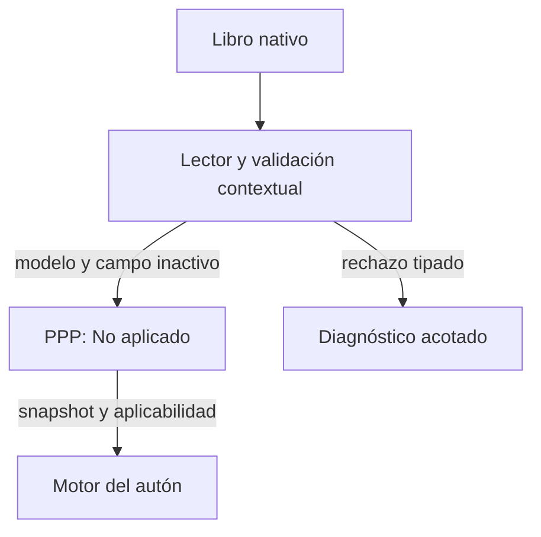

# PPP · lectura y campos inactivos

Propuesta `CHG-PPP-READ-VALIDATION-20261029`, contrato `CTR-PPP-INACTIVE-FIELDS`.

Un escenario nativo que valúa por m² puede conservar un cero legado en el campo de cap de mercado que no interviene en su cálculo. Rechazar toda la lectura por ese dato impide abrir el proyecto y compartirlo con el autón. La corrección preparada reconoce la inactividad de ese campo sin cambiar datos ni fórmulas.

Se admite la excepción de lectura únicamente con `inCapRateMercado===0`, `inValorM2Zona>0`, `state.porM2===true` y `state.p.capMercado===0`. El lector añade `state.inactive_fields:['inCapRateMercado']`; cliente y motor validan y conservan esa condición. Los otros escenarios y campos mantienen su contrato.

El esquema de captura conserva sus límites y `nullable:false`. Ningún escritor acepta un nuevo cap cero. Para volver a capitalización se necesita una tasa válida; el escritor existente revierte un cambio que active ese modo con datos inválidos. La interfaz permite capturar una tasa válida y conserva el cero original hasta una escritura autorizada. No sustituye cantidades por valores de referencia.

Los errores de validación autenticados se proyectan a `modelo_invalido` con cuatro identificadores: `code`, `field_id`, `scenario_id` y `reason`. Listas cerradas y límites de longitud impiden incluir texto arbitrario. Valores, fórmulas, IDs de libros, credenciales y stacks quedan fuera. Los errores desconocidos siguen siendo genéricos. Un rechazo de validación no provoca reintentos automáticos.

Las pruebas usan modelos sintéticos y el lector/escritor inspeccionados. El cotejo privado de datos reales es una lectura acotada, no una prueba de escritura ni una aceptación integral del consejo. La evidencia de fórmulas respalda únicamente la cadena de dependencias revisada. Los documentos públicos no contienen datos ni identificadores de los casos reales.

Estado: candidatos locales con pruebas; integración y publicación pendientes. Apps Script comparte editor con otra tarea: verificar reserva, versión y hash antes de editar o publicar, conservar sus módulos y no promover borradores ajenos. Pages, Render, versión GAS y apertura final se verifican por separado. Revertir este cambio conserva libros, versiones y recibos; puede restablecer el bloqueo de lectura y debe informarse.
