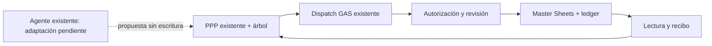

# PPP 4.0 · candidato semilla

Estado: propuesto y en implementación local, no desplegado.

PPP4 incremental: catálogo literal, grafo puro y semilla incompleta versionada dentro del frontend existente. Persistencia propuesta por módulo opt-in en la MISMA implementación GAS y tablas del master. Sin nueva URL, ACL, segundo motor financiero ni datos privados. Seed_id pre-alta es identidad de borrador, no board_case_id; promoción debe preservar vínculo explícito y no se presenta implementada.

## Flujo

## Invariantes y aceptación

- Semilla incompleta preserva null y fuente literal; superficie conocida debe ser positiva. Estado durable requiere recibo y lectura; el grafo distingue cero de ausencia.
- ACL vertical existente, revisión/CAS, repetición/payload mismatch y recuperación por lectura sin segundo POST.
- Catálogo 18 módulos/96 preguntas extraído sin convertir texto en reglas; grafo separa pertenencia y cálculo, rechaza ciclos.
- UI descarta respuesta al cambiar identidad/revisión; propuesta sólo manualmente confirmada; conexión ausente no simula éxito.
- Agente real, promoción a caso, calendario y recorrido online aún requieren integración/QA antes de nivel Básico.

## Reversión

Revertir commits de consumidores y desactivar capacidad semilla en la implementación existente. Preservar semillas, casos, recibos e historia; no borrar ni restaurar libros.
