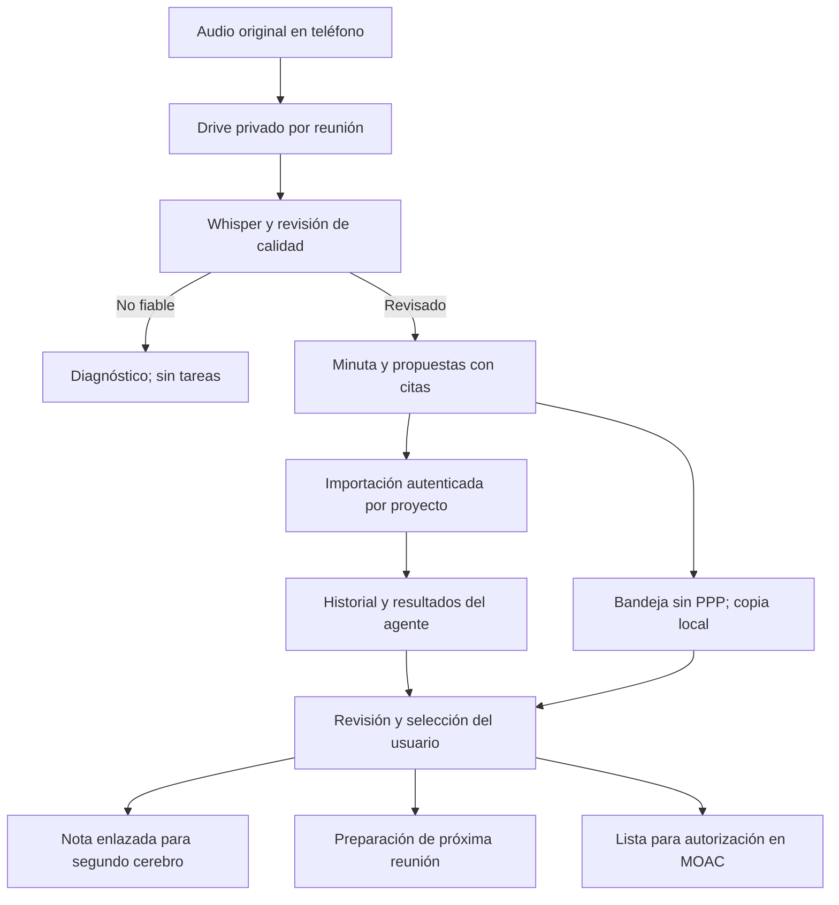

# Reuniones: resultados, seguimiento y pruebas

Solicitud: revisar arquitectura, segundo cerebro y recorridos de transcripción; conservar resultados y conectar la revisión a procesos existentes. No se asume integración por tener código o un workflow activo.

## Hallazgos corregibles

- La ficha histórica sólo conservaba metadatos. Las propuestas del JSON desaparecían al reabrir el panel. Se añade conservación privada de resultados y revisión por reunión.
- La bandeja sin PPP no recordaba fichas/selecciones. Se añade IndexedDB con transacciones y control de revisión; no equivale a copia en nube.
- Fechas imposibles y evidencias fuera de audio necesitan rechazo. El generador exige un recibo de audio revisado y hash coincidente; grabación no fiable produce diagnóstico, no tareas.
- Guardar metadatos y resultados son dos recibos. Un fallo entre ellos muestra archivo parcial y conserva reintento con el mismo ID.
- Dos revisores no deben pisarse: revisión esperada, ID de solicitud y registro de cambios; ante conflicto se conserva la propuesta local para descargar y recargar explícitamente.

## Flujo y fuentes

La bóveda explica y enlaza; Drive conserva archivos; cada tablero conserva su operación. Exportar Markdown no sincroniza Obsidian. La consulta `reuniones_consultar` recupera índice o resultados del caso, pero no ejecuta sus propuestas. Citas y texto importado son datos no confiables, nunca instrucciones de herramientas.

## Destinos y límites

| Resultado de reunión | Preparación disponible | Control que permanece |
|---|---|---|
| Encargo operativo | Selección y lista CSV para MOAC | Alta/asignación/autorización en motor nativo |
| Alternativa PPP | Nota con evidencia y pregunta pendiente | Cálculo y versión en PPP; no editar cifras desde audio |
| Prospecto inicial | Bandeja sin PPP y próximo contacto propuesto | No crear lead/PPP ni enviar mensajes por inferencia |
| Pago/cobro/inversión | Punto de revisión para Tesorería | Comprobante, contrato y autoridad financiera |
| Obra/interiores/trámite | Evidencia a contrastar y responsable por confirmar | Captura/verificación/autorización existentes |
| Documento | Enlace a la fuente original | Permisos Drive; lectura del documento por separado |
| Reunión futura | Agenda de temas en Markdown | Fecha/zona/invitados y autorización del envío |
| Decisión o duda | Nota, cita y aclaración pendiente | No convertir sugerencia en acuerdo aprobado |

## Inventario inspeccionado

Se consultó el catálogo de workflows de 22 repositorios accesibles, con 160 entradas. El atlas contiene 18 procesos. No equivale a auditar cada línea de cada repositorio ni a probar cron jobs en ejecución.

| Repositorio | Workflows catalogados | Desactivados |
|---|---:|---:|
| yodesarrollomx/sala-edicion | 46 | 0 |
| yodesarrollomx/yod-portal | 10 | 0 |
| yodesarrollomx/potenciales-yod | 5 | 0 |
| yodesarrollomx/yodesarrollo-board | 2 | 0 |
| yodesarrollomx/aurum-board | 10 | 0 |
| yodesarrollomx/board-aurum | 2 | 0 |
| yodesarrollomx/yod-despacho | 2 | 0 |
| yodesarrollomx/EMDevaluacion360 | 4 | 0 |
| yodesarrollomx/emd-evaluacion-360 | 1 | 0 |
| yodesarrollomx/sala-operacion | 1 | 0 |
| yodesarrollomx/prueba-dominio | 1 | 0 |
| yodesarrollomx/yodesarrollomx.github.io | 2 | 0 |
| yodesarrollomx/real-miramar-board | 2 | 0 |
| yodesarrollomx/plan-potencial | 2 | 0 |
| yodesarrollomx/pintarron | 2 | 0 |
| yodesarrollomx/interiores-aurum | 2 | 0 |
| yodesarrollomx/crokiss | 2 | 0 |
| yodesarrollomx/board-flujo-yod | 2 | 0 |
| yodesarrollomx/aurum-experiencia | 2 | 0 |
| yodesarrollomx/alquimia-urbana | 2 | 0 |
| yodesarrollomx/Co-desarrolladores-Yod | 2 | 0 |
| alexpueblag/yod-agent-cloud | 56 | 8 |

Procesos revisados en el atlas:

- PROC-VENTA-PPP · Captación y venta de Plan de Potencial; 7 pasos; vacíos: Confirmación Calendar y seguimiento diario requieren verificación; No se comprobó enlace folio de lead a contrato y cobro.
- PROC-VENTA-CROKISS · Captación por herramienta gratuita; 4 pasos; vacíos: No se comprobó integración de prospecto con CRM central ni tasa a venta.
- PROC-INVERSION · Venta y aportaciones de codesarrolladores; 7 pasos; vacíos: Conciliación con banco y Tesorería no comprobada; Alta de inversión y aportaciones usa secuencia de escrituras; atomicidad debe revisarse.
- PROC-PROYECTO · Proyecto desde potencial hasta venta; 4 pasos; vacíos: Etapas del registro son una fotografía mantenida manualmente; No se demostró relación persistida de folios entre todos los motores.
- PROC-OBRA · Avance y autorización de obra; 4 pasos; vacíos: Autorización no equivale a movimiento de Tesorería; Existe captura por autorizador que queda autorizada directamente.
- PROC-MARGEN · Control de margen por proyecto; 7 pasos; vacíos: Cadena objetivo propuesta; integración completa no demostrada; Interiores, obra, trámites y Tesorería necesitan claves y definiciones comunes.
- PROC-DIRECCION · Aprobación y ejecución desde Despacho; 5 pasos; vacíos: Rutina externa de correo no inspeccionada; Cierre debe distinguir enviado de resuelto con contraparte.
- PROC-CONTENIDO · Producción de contenido con compuertas; 6 pasos; vacíos: Atribución pieza a lead y venta no comprobada; Migración histórica a nube necesita reconciliación de dependencias; Atribución campaña/pieza a leads/citas sí existe en Marketing; cierre a venta/margen no comprobado; Sala: reglas, cola y ejecución viva contrastadas en el recorrido inspeccionado; cuota y disponibilidad de todos los respaldos/motores y publicación a redes siguen sin certificarse.; Desacoplamiento editorial/producción corregido: las cinco decisiones inspeccionadas dieron nuevas tarjetas. Falta aceptación editorial de las nuevas láminas, terminar las etapas aprobables y conciliar siete fallos históricos sin reactivarlos automáticamente.; Cuotas limitadas observadas en Cloudflare/Gemini imagen; HF ruta antigua410 y automático402. Pollinations720×960 corregido y probado con motor real; no certifica disponibilidad permanente de todos los proveedores.; Tras el lote inspeccionado quedan18 láminas anteriores por preparar y7 fallos históricos por conciliar. Las nuevas láminas requieren aprobación editorial antes de sus etapas y cortes.; Tiny SD retirado de generación/respaldo/revisión por Dirección. La falta de cuota de motores permitidos conserva las regeneraciones pendientes; el primer lote observado tuvo7 sin toma, sin suplirlas con el modelo retirado..
- PROC-COBRO · Cobranza y caja; 5 pasos; vacíos: No se comprobó facturación integrada ni conciliación bancaria; Pago reportado o autorizado no debe confundirse con efectivo recibido.
- PROC-INTERIORES · Selección y presupuesto de interiores; 5 pasos; vacíos: No se comprobó conexión de selección con pedido, recepción o Tesorería; Aislamiento por proyecto y reglas de modificación deben comprobarse en backend vivo.
- PROC-TRAMITES · Trámites e hitos de desarrollo; 4 pasos; vacíos: Lectura agrupada de Alquimia no prueba propagación transaccional de cambios entre proyectos; No se comprobó conexión costo de demora a margen consolidado.
- PROC-METAS · Metas, objetivos y ejecución semanal; 4 pasos; vacíos: Hay dos motores distintos; comprobar consistencia e IDs al mover, archivar o eliminar tareas; No se comprobó que el cierre de tarea dispare automáticamente cierre de objetivo.
- PROC-EMD-PROFILES · Perfil fotográfico privado de evaluación; 7 pasos; vacíos: Selección y recorte requieren decisión de la persona; La apariencia por estado no sustituye el texto, el foco ni el estado confirmado del servidor; el atlas no contiene fotos ni metadatos personales; Habilitar y verificar servicio avanzado Drive v3/API; si falta, el recorrido rechaza operación sin alternativa permisiva; Circuito privado del agente y tratamiento uniforme están propuestos; no publicados por documentarlos; No usar una foto real como fixture ni copiar originales/derivados o metadata privada al atlas público.
- PROC-EMD-DRAFTS · Recuperación revisada de borrador local; 4 pasos; vacíos: Revisión y decisión de recuperar requieren consentimiento; no hay recuperación ni cierre automáticos; Persistencia limitada al navegador y enlace; no garantiza recuperación tras borrar almacenamiento; Pruebas táctiles y escritorio sintéticos no certifican Safari ni un teléfono físico.
- PROC-EMD-CONTACTS · Preparación privada de contactos y recordatorios; 4 pasos; vacíos: El envío real requiere destinatarios verificados y autorización específica; no forma parte de esta propuesta; La vista previa y las pruebas sintéticas no sustituyen revisión humana de nombres y correos; No emitir ni reemitir accesos y no reiniciar evaluaciones al preparar un recordatorio.
- PROC-EMD-LOAD · Carga ligera y espera orientativa de evaluación; 3 pasos; vacíos: La duración depende también del arranque de Google y la conexión. La medición de peso no garantiza una latencia universal.; El almacén permite vincular identidad y respuestas: confidencialidad y acceso restringido no equivalen a anonimato..
- PROC-BROKER-PREEVALUATION · Preevaluar un terreno desde Masterbrokers; 4 pasos; vacíos: Los correos individuales deben estar vinculados canónicamente en CRM; Cobertura de fuentes de entorno variable; preevaluación no equivale a aprobación del plan.
- PROC-BANDEJA-NUBE · Bandeja del Despacho con APIs de nube; 5 pasos; vacíos: Consentimiento inicial de Google y confirmación del libro efectivo mediante sesión de Dirección.; Corte de la rutina Claude sólo después de dos ciclos de observación y pruebas; primer envío aprobado real se acredita por separado.; Si la rutina original captaba correos/creaba tarjetas, portar esas reglas antes de dar por sustituido su alcance; este ejecutor sólo procesa BANDEJA y cambios/respuestas existentes..

## Coordinación y publicación

Los cambios de perfil/voz y el puente MOAC tienen PR independientes. Esta entrega no modifica sus archivos de interfaz compartidos ni publica sus motores. Los workflows desactivados se conservan así; las pruebas nuevas usan ejecutor local y los controles existentes. No se crean tareas periódicas ni se promete seguimiento fuera de una ejecución activa.

Pruebas: casos sintéticos de reintento, reinicio, conflicto, archivo parcial, autorización, calidad, fechas y exportación. Se cotejan por separado las grabaciones privadas aportadas; sus contenidos no se publican aquí. La prueba móvil automatizada no acredita micrófono ni grabación con pantalla bloqueada en iPhone físico.

Límites: resultados por ficha hasta32KB; archivo por caso hasta480KB/200 reuniones, sin eliminación automática. Si se alcanza el límite, se informa y se conserva el original en Drive. El paso audio→chat y la importación de ficha siguen siendo manuales.

Reversión: retirar nuevas rutas/consumidor conservando el almacén privado y las fichas. Una revisión guardada no equivale a una acción empresarial aprobada.

## Evidencia local de esta revisión

641 pruebas Portal y 530 del servicio correctas; una del servicio omitida por su condición previa. Regresión original del grabador: ocho recorridos Chromium correctos. Seguimiento: archivo parcial, acuse perdido, revisión concurrente local/servidor, recuperación y aislamiento de proyecto probados con datos sintéticos. Whisper CPU: voz clara transcrita; la señal muy baja exige revisión y no se califica sólo por volumen. El decodificador sin protección inventó una despedida ante silencio; el pipeline real con protección devolvió cero segmentos. No se generaron tareas de esa muestra.
