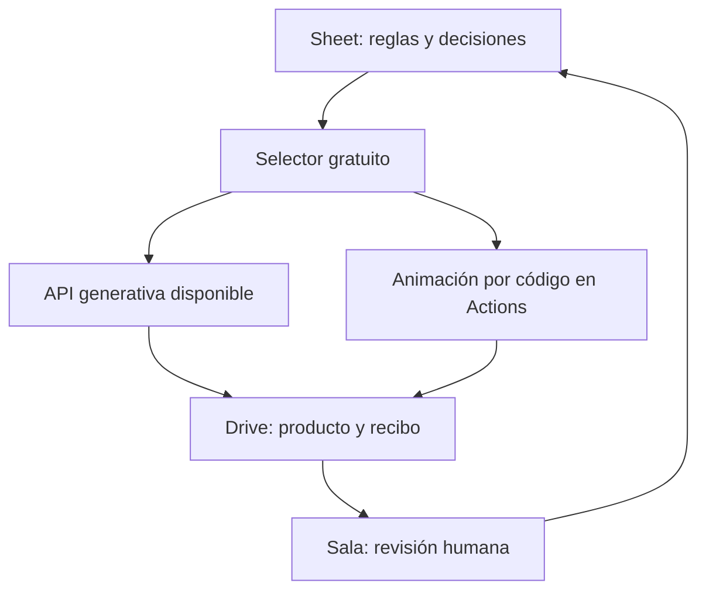

# Sala: producción adaptativa en nube

Selector determinista con exploración 20%, exclusión de pagos/locales/vetos, límites diarios y evidencia de intentos. Animación tipográfica por código en Actions cubre la voz completa; distinta de video generativo. La aprobación editorial continúa manual.

Dirección pide implementar selección adaptativa gratuita, animación por código y operación exclusivamente en nube, sin Mac ni sesiones Claude/Codex.

Pruebas: Selector: veto, cuota, pago, repetición determinista y exploración. Render real sintético y duración con ffprobe; montaje sin congelación. Regresiones aisladas y ejecución Actions con recibo durable separada de aprobación.

Reversión: Desactivar nube_adaptativa y revertir PR; conservar cola, decisiones y archivos.
