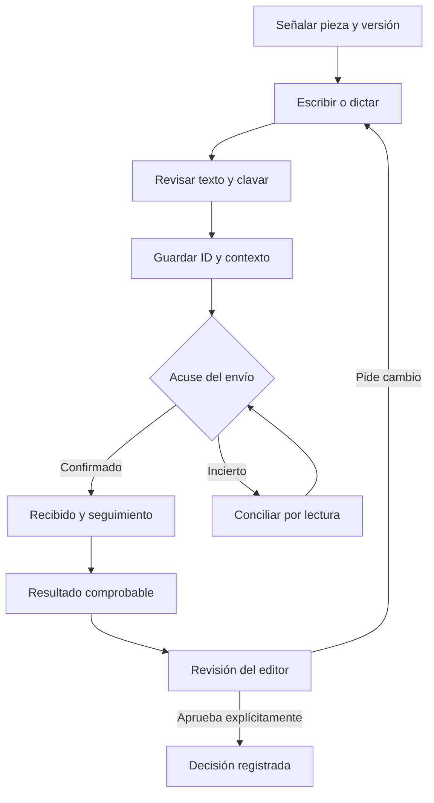

# Sala · punto 4: correcciones y aprobación

Registro previo: CHG-SALA-CORRECCIONES-20261015.

La chinche conserva el contexto anterior al dictado y no altera decisiones. La navegación y comparación tampoco votan. El dictado parcial no se envía como texto final; se detiene y revisa antes de clavar. Cada envío guarda su checkpoint antes del POST. Una ausencia en la ventana de PRODUCCION no prueba que no se haya escrito: no repetir automáticamente.

Un issue cerrado sin resultado queda por verificar. Un cambio integrado con comprobante se distingue de la aprobación editorial de una toma. Las notas permanecen privadas; los nuevos issues sólo llevan identificador y enlaces técnicos. Los históricos se conservan.

Pruebas con dobles, revisión móvil/escritorio y CI. El despliegue del frontend no acredita micrófono físico, proveedor disponible ni una aprobación de negocio. Revertir código preservando registros.
