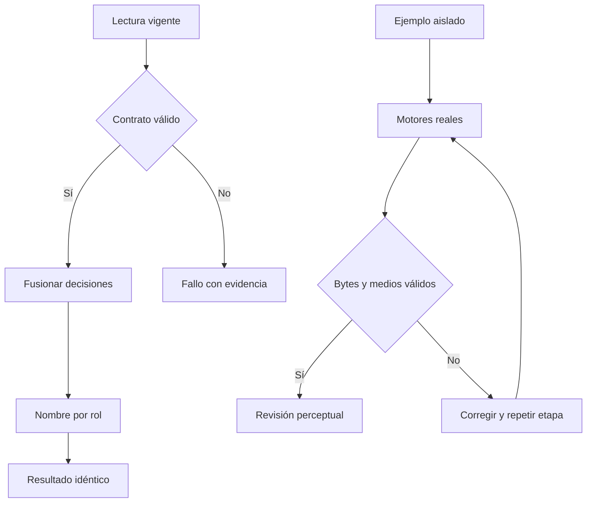

# Sala: ejemplo verificable y lectura editorial

Propuesta CHG-SALA-EJEMPLO-20261015, registrada antes de implementar.
Una sonda real agotó la lectura del día; reglas, cola y catálogo sí respondieron.
En el espejo se reprodujeron 240 lecturas de CONFIG para 240 firmas ganadoras
de sólo dos editores. Esto demuestra el patrón N+1, no todavía la causa exclusiva
del tiempo de red ni que el espejo sea la implementación activa.

La reparación resuelve el nombre visible una sola vez por rol dentro de cada
fusión. Cada invocación vuelve a leer; no hay caché de permisos o credenciales.
Las marcas, notas, sellos, orden y vetos conservan la misma transformación.
El backend original exige cotejo, respaldo privado y publicación de la misma
implementación antes de acreditar efecto real.

El ejemplo utiliza la ruta técnica existente, conserva sus archivos en Drive
privado y no agrega votos ni propuestas ficticias. Imagen, voz, movimiento y
corte se verifican por separado. Parallax no se presenta como video generativo.
Un archivo válido no acredita calidad editorial; la aprobación del editor sigue
siendo suya. Revertir código/backend conserva decisiones, archivos y recibos.

## Ejecución observada

Ejemplo 38814111428 completado: 254.1 segundos de producción, seis archivos privados verificados tras descarga, corte H264/AAC de 18.167 s a 1080x1920 y 30fps. Inspección de lámina y fotogramas completada; éxito técnico no equivale a aprobación editorial. Sonda 38814278019: reglas, cola y catálogo respondieron; día agotó tres intentos.

Regresión: 240 firmas pasan de 240 lecturas CONFIG a 2, conservando 120 vetos y notas; una invocación posterior relee nombres. Sala: 504 Python, 111 Node, 13 verificaciones. Atlas: 776 tests y verificadores OS, portal, accesos y obra. El despliegue vivo se acredita en el cierre de Sala.
