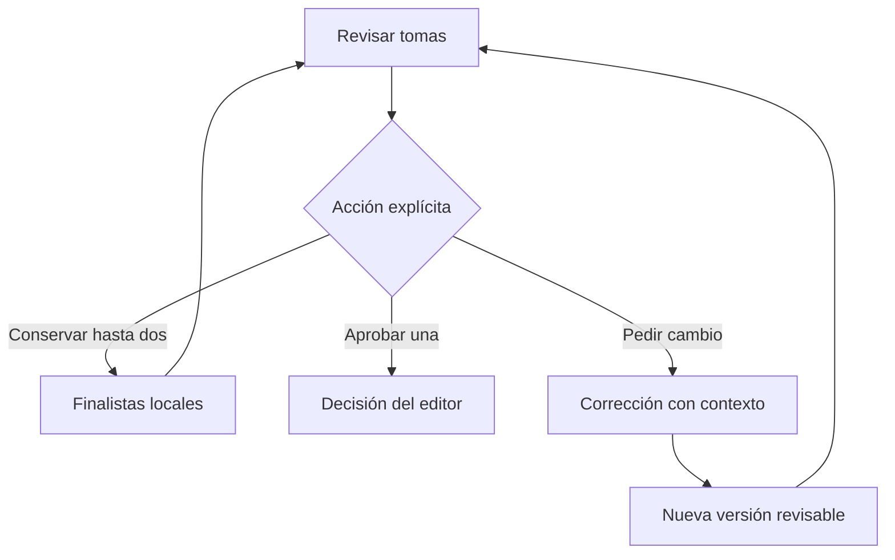

# Sala · finalistas y medición

Propuesta CHG-SALA-EVALUACION-20261015, registrada antes de implementar.

La preselección es un borrador local de hasta dos tomas. Conserva rol, propuesta,
lámina, versión y conjunto de candidatas; sobrevive a una recarga en el mismo
navegador. No se sincroniza con otros dispositivos ni crea trabajos. La decisión
editorial sigue en su circuito autenticado existente.

La telemetría distingue `laminas_preparadas` y `tomas_obtenidas`. El campo
histórico `generadas` conserva su unidad: láminas. Tomas obtenidas incluye
resultados recuperados y no acredita nuevas llamadas a un proveedor o gastos.
Los reportes anteriores no se reescriben ni se reinterpretan como facturación.

La evaluación exige casos reales con evidencia de resultado, tiempos con
denominador, costo facturado separado de configuración y fallos conservados.
Un resultado sin costo verificable queda sin costo confirmado; no vale cero.
La expansión de autonomía requiere aceptación humana y resultados observados;
la implementación de estos controles no la activa.

Pruebas: límite de dos, recarga, cambio de rol/versiones, almacenamiento fallido,
índices originales filtrados y cero votos al conservar. Mesa: una lámina con
dos tomas, sin trabajo y resultados parciales. Sólo fixtures/dobles.

Reversión: revertir el PR sin borrar almacenamiento, decisiones, cola o medios.
