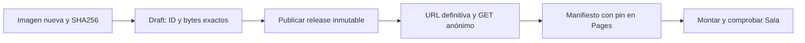

# Sala: continuidad de medios nuevos

La autorización de migración persiste. Este ajuste conserva el contrato MEDIOS.

GitHub devuelve URLs `untagged-*` mientras el release es draft. Sólo se toleran en la comprobación privada previa, con ruta del repositorio, nombre y digest exactos. Nunca se usan como referencia pública. El recibo público, inmutabilidad y presupuesto siguen exigidos. Evidencia inicial: Actions39072235135 y diagnóstico39072300122. Falta completar sonda y producción.
