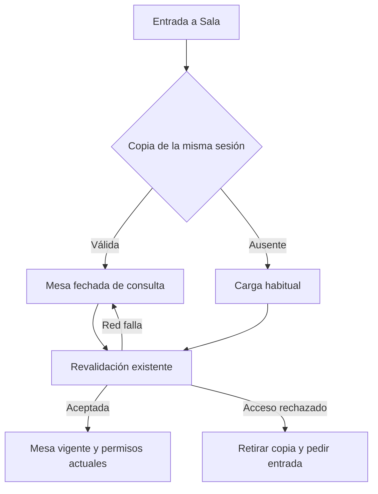

# Sala: última mesa guardada

Propuesta CHG-SALA-MESA-LOCAL-20261020, autorizada por Dirección el 20-oct-2026.

SHEET-SALA conserva la fuente de verdad. La caché es desechable, por endpoint, sesión y rol; caduca, tiene límite de tamaño y nunca guarda claves renovadas. Guarda día y grupos coherentes, no HTML. Los borradores y la cola editorial se conservan aparte y la copia nunca los sobrescribe. Consultar la copia no genera POST ni autoriza votos.

Pruebas: red retenida durante reapertura, navegación útil, actualización, identidad distinta, rechazo, corrupción, cuota y decisiones pendientes. Usar exclusivamente datos sintéticos. La primera visita necesita una descarga; el objetivo de menos de un segundo no se acredita por el cambio de código. Revertir frontend por PR conserva Sheets, medios, cola y borradores.
