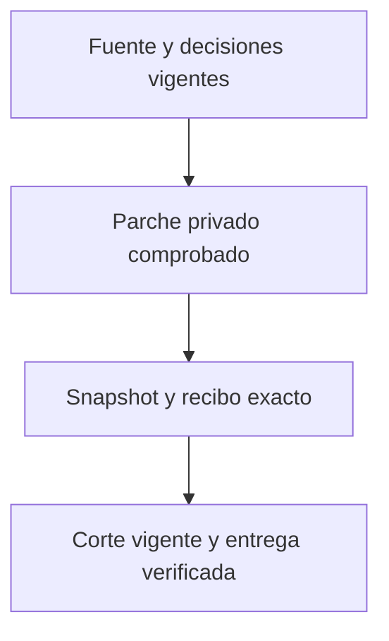

# Sala · corrección acotada de metadatos de corte

Propuesta previa a implementación. Los metadatos históricos pueden contradecir las reglas actuales aunque el editor haya seleccionado imágenes y textos válidos. La corrección conserva esas decisiones y no permite fabricar aprobación, resucitar fuentes retiradas ni convertir una lámina en video.

El operador aporta un parche privado con fuente, SHA y pares original/nuevo. Sólo se admiten campos de metadatos expresamente permitidos; la narración efectiva, texto visible seleccionado, medios, identidad y firmas deben permanecer iguales. La validación usa la tira resuelta con decisiones actuales, no el JSON aislado.

El respaldo privado precede la escritura. El mutex existente serializa publicación; no se atiende COLA hasta acreditar el recibo de la versión corregida. Una segunda lectura de fuente, reglas, decisiones y dependencias confirma vigencia. Cada transición se registra y se relee; un acuse incierto no se reenvía.

La reanudación se limita a cortes fallidos exactos que siguen siendo elegibles. El estado terminado, la publicación de datos, la producción del archivo y su montaje editorial se acreditan por separado. No se envían correos ni se publica en redes.

Pruebas: fuentes cambiantes, campos ajenos, narración modificada, imagen distinta, votos/vetos, falta de dependencias, publicación no confirmada y respuesta perdida. Reversión: conservar fuentes, originales, medios y decisiones; restaurar únicamente campos todavía coincidentes o revertir código mediante PR.
