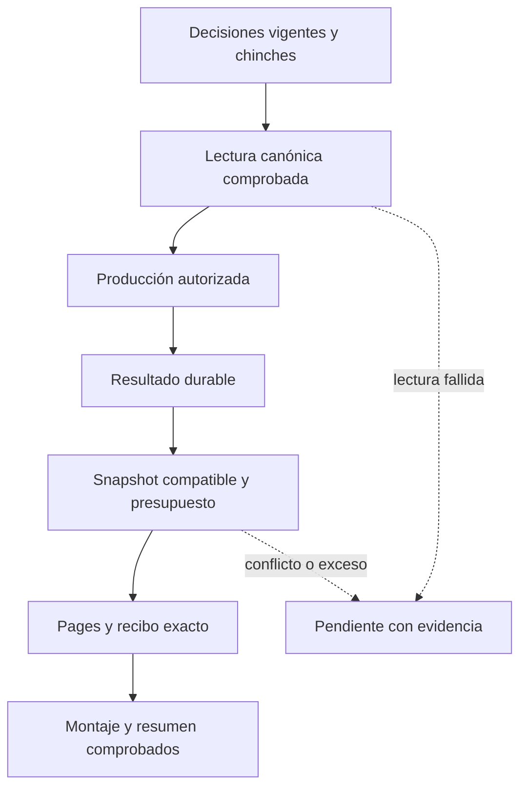

# Sala · continuidad y publicación comprobables en nube

Registro de **CHG-SALA-NUBE-20261015**, revisión `2026-10-15.sala-nube.1`.
Dirección autorizó expresamente la auditoría y reparación técnica en la conversación
del 14-oct-2026 en Hermosillo, 15-oct UTC. La autorización conserva decisiones
editoriales, vetos, permisos, destinatarios y reglas de negocio existentes.

Este registro precedió a la implementación. La reparación está integrada en
PR308, commit `e4da08887e45e984be8ea945ce607db464b0fb52`, con cinco CI del head
revisado en verde. Pages, Plan, Revisión y Cierre se comprobaron por corridas
concretas; el [registro de evidencia y nueva fase de capacidad](sala-medios-publicos-20261015.md#evidencia-anterior-separada-de-esta-fase)
delimita su alcance. No acreditan correo recibido ni producción nueva.
Las pruebas históricas del atlas conservan su fecha y alcance.

## El proceso existente

La Sala conserva su backend, su hoja, Productor, Mesa, Ejecutor, puente de
chinches, Actions y publicador. El vigilante residente de Render conserva su
código; su conexión GitHub se comprueba por separado. La continuidad debe
depender de estos procesos en nube y sus recibos persistentes, con la revisión
editorial humana vigente.

Cada transición acredita sólo su propio resultado. Una mesa vacía puede tener
decisiones históricas vigentes; un dispatch acredita solicitud; un archivo
generado acredita producción durable cuando se verifica; la publicación exige
el recibo exacto de la versión accesible. Publicar el tablero no publica a redes.

## Contratos que se conservan y amplían

| Recorrido | Regla técnica | Evidencia de cierre |
|---|---|---|
| Transporte | Recuperación acotada sólo para GET declarados de lectura; validar cuerpo y error de aplicación | Lectura válida o fallo explícito; ningún cero fabricado |
| Mutación | Sin reenvío genérico después de timeout o ACK ambiguo | Relectura y conciliación del estado o recibo antes de repetir |
| Snapshots | Compatibilidad histórica, deltas con padre/manifiesto/hash y replay comprobados | Restauración acumulativa sin pérdida ni borrados inferidos |
| Exclusión | Propietario ligado a `run_id` y `run_attempt` reales; comprobar estado remoto tras ACK perdido | Un intento no toma el lease de otro por compartir ejecución |
| Pages | Comprobar presupuesto técnico antes de publicar | Recibo exacto; exceso conserva el último sitio y los medios históricos |
| Correo | Decisiones históricas, pendientes, producido y publicado separados | Conteos de fuente válida y publicación acreditada; recepción se comprueba aparte |
| Chinches | Dispatch sólo solicitado; `not_planned` conserva su motivo; cumplimiento por resultado | Registro confirmado por ID/proof; relectura después de etiqueta fallida o POST ambiguo |

El contrato de transporte es `CTR-SALA-TRANSPORTE-NUBE`. El puente de chinches
usa `CTR-SALA-CHINCHES-RECIBO`. Se amplían los contratos existentes
`CTR-SALA-SNAPSHOT-ONLINE`, `CTR-SALA-DECISIONES-PRODUCCION` y
`CTR-SALA-CIERRE-ONLINE`.

Un GET de un backend de negocio puede tener efectos: sólo las lecturas
declaradas reciben recuperación automática. Para POST, un rechazo explícito se
trata según su contrato específico. Una respuesta perdida exige conciliación;
no permite duplicar correo, triggers, cola, montaje o anotaciones de producción.

Los snapshots históricos se conservan. Un delta no puede convertir la ausencia
de un archivo en borrado. Release, activo o lease con ACK perdido se releen y
contrastan por identidad y hash antes de una nueva escritura. Superar el
presupuesto de Pages detiene la publicación; no autoriza eliminar material
histórico ni cambiar reglas editoriales.

El despliegue tiene dos fases. Primero se publica el lector compatible v1/v2,
manteniendo la emisión v1 predeterminada. Sólo después de comprobar el drenaje
de ejecuciones y consumidores anteriores se puede activar
`SALA_SNAPSHOT_INCREMENTAL=1`. Integrar código no demuestra ese drenaje.

El correo del backend vivo y su fuente en GitHub se verifican por separado.
Modificar el espejo `.gs` no demuestra que esté desplegado. No se cambia el
destinatario ni se envía desde una identidad distinta para simular el servicio.
Un push del workflow de cierre no solicita entradas de correo ni repite la
comparación histórica. Se conservan las opciones manuales explícitas existentes.

El puente de chinches conserva sus lectores y el texto original. Un cierre
`not_planned` no es un resultado resuelto. Antes de repetir una anotación por
fallo de etiqueta o acuse incierto se relee producción y se compara ID/proof.
El agente sigue sin decidir aprobaciones ni dar por cumplido trabajo pendiente.

## Comprobaciones y reversión

La aceptación requiere regresiones sintéticas de transporte, snapshots
históricos/deltas, conflicto entre intentos, ACK perdido, presupuesto excedido,
conteos históricos y deduplicación de chinches. Después de integrar código,
comprobar producción, recibo de Pages, montaje y correo del backend vivo según
el alcance autorizado. Ninguna prueba crea decisiones o proyectos ficticios.

Revertir los PR y la configuración técnica afectada conservando decisiones,
colas, chinches, medios, bases/deltas, recibos e historial. Restaurar el último
snapshot confirmado. Si ya se emitieron deltas, generar y comprobar primero
un snapshot completo v1 con el lector v2 antes de revertir lectores o publicador.
La reversión no cancela rutinas ajenas ni cambia ACL,
destinatarios o reglas comerciales.
