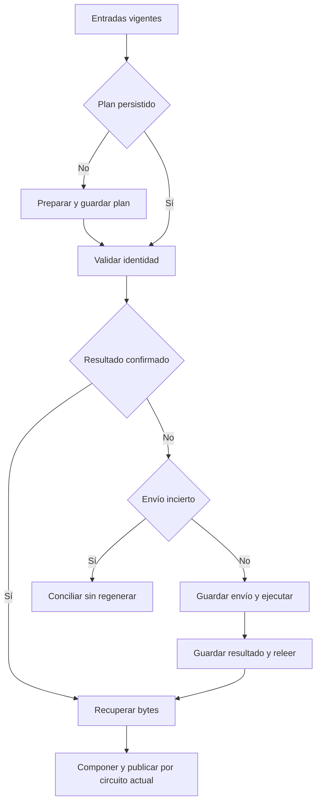

# Sala · punto 3: ejecución recuperable

Propuesta CHG-SALA-PERSISTENCIA-20261015. Registro previo a implementación.

La identidad de cada toma conserva su carpeta, lámina y variante. Las entradas se comparan antes de reusar; un cambio incompatible exige nueva versión. El plan privado guarda texto original, nota, referencia descriptiva, receta, instrucciones efectivamente enviadas y configuración permitida sin credenciales.

Los recibos privados se guardan en drafts propios con un tipo distinto al snapshot público. Nunca convertirlos en releases publicados ni incluirlos en el bundle. Cada escritura ambigua se reconcilia mediante relectura exacta; un resultado incierto no autoriza otra generación. Una negativa explícita de cuota sin imagen permite un intento posterior. Los cron, permisos, selección humana y almacenes actuales se conservan.

Pruebas: negaciones de edición, corrección visual con motor caído, límite de 14 palabras sólo en texto nuevo, hash original en reuso; proceso nuevo, bytes dañados, ACK perdido y ausencia de duplicados. Una prueba sintética de Actions demuestra independencia del chat; no acredita calidad editorial ni correo recibido.

Reversión: revertir código conservando todos los recibos, snapshots y decisiones.
