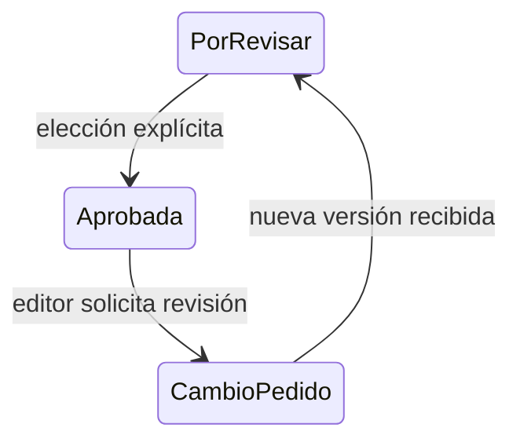

# Sala · continuidad de la revisión

Propuesta CHG-SALA-REVISION-TOMAS-20261020, previa a implementación.

La comparación abre en escritorio sin votar. La elección explícita avanza en la secuencia; cambiar de página no decide. Una corrección posterior de una aprobada usa reapertura con nota y origen conocidos, conserva la aprobación anterior y exige editor con datos vigentes. No cambia backend, ACL, productor ni publicación.

Estados operativos permanecen en Sheet. La comparación y navegación son sólo interfaz. Se probarán con datos sintéticos roles, notas, identidad, persistencia y recorrido móvil/escritorio. Publicar código no prueba generación nueva ni aceptación de contenido. Reversión por PR, conservando decisiones e historial.
