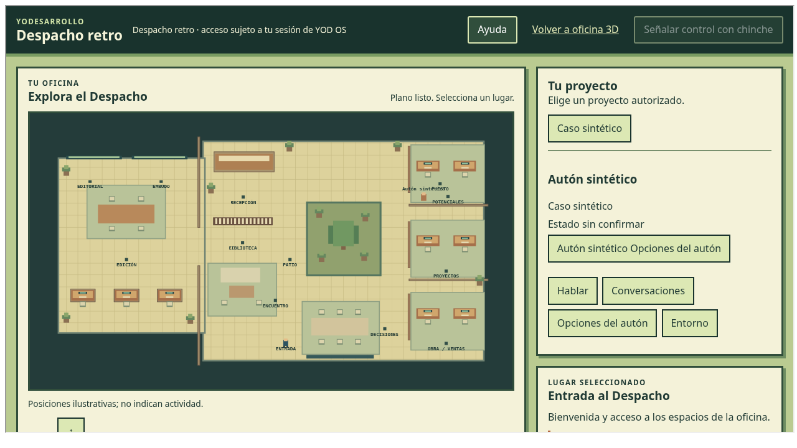

# Despacho retro · entrega local

30 de octubre de 2026. Implementación integrada para revisión; sin publicación ni acreditación de servicios reales.

## Resultado

La oficina se dibuja con Canvas2D y controles DOM. Conserva los trece lugares, límites, anexo y colisiones del layout canónico. Los perfiles autorizados aparecen como figuras con posiciones ilustrativas; esas posiciones no representan actividad real. Los paneles reutilizan los controladores actuales de proyectos, conversaciones, voz, expediente, trabajo y reuniones, con retratos DOM inyectados en los núcleos compartidos. No se cambian los contratos de Sheets, GAS, Portero ni el servicio de agentes.

La entrada del portal `os/?office=retro#/despacho` activa la vista bajo los permisos actuales. La ruta directa `despacho-retro/` ofrece una vista de desarrollo declarada, sin autoridad ni servicios conectados. La vista 3D continúa disponible.

## Verificación

- Suite Node completa: **1126/1126 aprobadas**. Focales retro: **14/14**.
- Arquitectura, impacto, `verify-os`, `verify-portal`, `verify-obra-app` y `git diff --check`: aprobados. `verify-accesos` utiliza `ACCESOS_REF=4694f7db9a3de4d5415e711d090140e6a2875f01` y el proxy del entorno.
- `node tests/despacho-retro-browser.cjs --run`: Chromium 154, autoridad y caso sintéticos, DOM real; abre PPP, actividad, reunión, avatar y conversación; verifica revocación y denegación posterior, teclado con modal, selección de chinche y exclusión de biblioteca. Todas las solicitudes ajenas al servidor local se sustituyen o bloquean.
- Capturas en 1440×900, 390×844, 844×390 y 320×568: trece controles, sin errores de página ni desbordamiento horizontal. El iframe integrado también se comprobó en 390×844. Canvas denegado conserva aviso y navegación DOM; se probaron cuatro destinos representativos.
- El cierre y reapertura del puesto respetan la protección canónica de 700 ms que absorbe los clics residuales tras señalar una chinche. Un intento inicial dentro de esa ventana fue absorbido; el recorrido separado del gesto pasó sin modificar la lógica de cierre.
- El grafo estático y el recorrido de navegador, incluida la ficha del personaje, no cargan Three ni el retrato 3D.

## Carga observada

Comparación local de una muestra por vista, mismo Chromium 154, viewport 1440×900, iframe sin autoridad, WebGL con SwiftShader y lectura de `performance.getEntriesByType('resource')` tres segundos después de cargar. Servidor local sin compresión; destinos externos bloqueados. Ambos montajes quedaron sin errores y expusieron la API de oficina.

| Vista | Recursos observados | Bytes locales decodificados | Three |
| --- | ---: | ---: | --- |
| 3D | 134 | 4,076,267 | Sí |
| Retro | 103 | 1,589,450 | No |

La muestra retro tiene aproximadamente **61% menos bytes de recursos locales**. Es una medición de carga local inicial, no una medición de RAM, fluidez en dispositivos físicos, transferencia comprimida ni latencia de los servicios. No permite prometer funcionamiento en cualquier aparato.

## Límites y publicación

Faltan la aceptación visual de Dirección, Safari/WebKit y dispositivo físico objetivo, una sesión autorizada real y el recibo completo de una chinche en producción. El ACK simulado sólo acredita que el compositor acepta el mensaje de prueba. Biblioteca permanece excluida del señalamiento porque su zona no está reconocida por el contrato canónico; su navegación sí funciona. Las funciones que el despacho actual mantiene pendientes conservan ese estado.

La publicación debe usar el PR revisado y los permisos vigentes. Reversión funcional: retirar `office=retro` de la URL para volver a la oficina 3D. Si fuese necesario revertir el código, revertir el commit de implementación mediante otro PR; no modificar datos ni restaurar hojas.

La [auditoría independiente](auditoria-i1.md), el [contrato de integración](contrato-integracion.md) y la [cola de equipo](arranque-equipo.md) detallan las comprobaciones y las responsabilidades.
